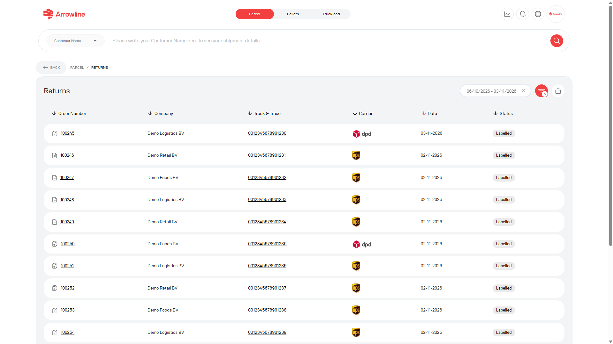
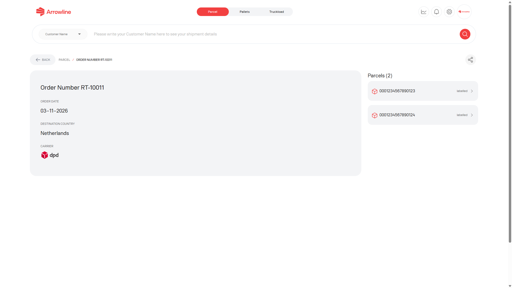
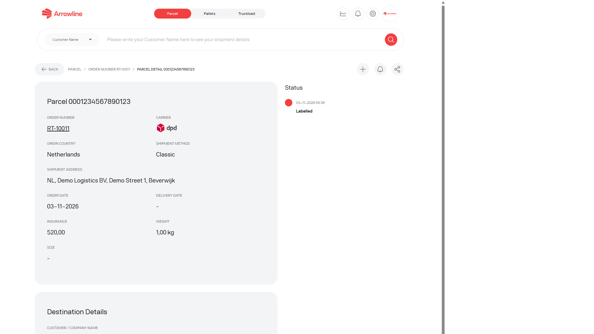

Retouren sind Datensätze der Rückwärtslogistik. Sie haben eine eigene Liste und sind nicht mit [Sendungen in Pakete](/de/parcels/shipments) gemischt.

<Frame caption="Beispielbild mit Dummy-Daten von Demo Logistics BV.">
  
</Frame>

## Eine Retoure finden

<Steps>
  <Step title="Öffnen Sie Pakete">Melden Sie sich an und öffnen Sie den Arbeitsbereich Pakete.</Step>
  <Step title="Öffnen Sie Returns">Nutzen Sie die Retourenliste, oder öffnen Sie eine Retoure vom Dashboard von Pakete.</Step>
  <Step title="Setzen Sie die Filter">Nutzen Sie die Datums- und Retourenfilter, die auf der Seite angezeigt werden.</Step>
  <Step title="Öffnen Sie die Retoure">Wählen Sie die Retoure, die zum benötigten Auftrag oder Paket passt.</Step>
</Steps>

Die Liste kann Retourenkennungen, verknüpfte Auftrags- oder Paketwerte, Statuskennzeichen und Daten zeigen. Ein fehlender Link wird als nicht verfügbar angezeigt. Behandeln Sie eine Retourenkennung nicht als Nummer einer ausgehenden Sendung.

## Retourendetail

Die Detailseite der Retoure ist die Ansicht auf Auftragsebene. Sie kann zeigen:

- Angaben zum Retourenauftrag
- Links zu Paketen in der Retoure
- Einen Hinweis oder Link, wenn bereits ein Support-Ticket verbunden ist

<Frame caption="Beispielbild mit Dummy-Daten von Demo Logistics BV.">
  
</Frame>

Öffnen Sie ein Paket, wenn Sie den Datensatz auf Barcode-Ebene brauchen. Öffnen Sie das verknüpfte Ticket, wenn Support bereits eingebunden ist.

## Paketdetail der Retoure

Die Paketseite kann Paketangaben, die Ereignis-Zeitachse, Statusbenachrichtigungen und ein verknüpftes Ticket zeigen.

<Frame caption="Beispielbild mit Dummy-Daten von Demo Logistics BV.">
  
</Frame>

Fehlende Abhol- oder Empfangsereignisse bedeuten nicht, dass die Retoure abgeschlossen ist. Lesen Sie die vorhandenen Ereignisse, warten Sie dann auf die nächste Aktualisierung oder [erstellen Sie ein Ticket in Pakete](/de/parcels/tickets), wenn die Retoure untersucht werden muss.

<Info>
  Auf der Paketseite der Retoure können Sie Statusbenachrichtigungen ein- oder ausschalten, wenn diese Steuerung angezeigt wird.
</Info>
