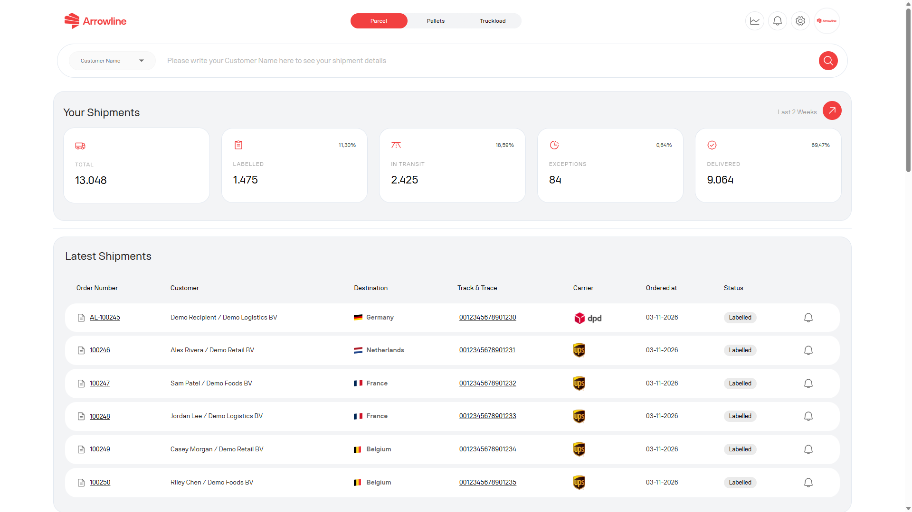
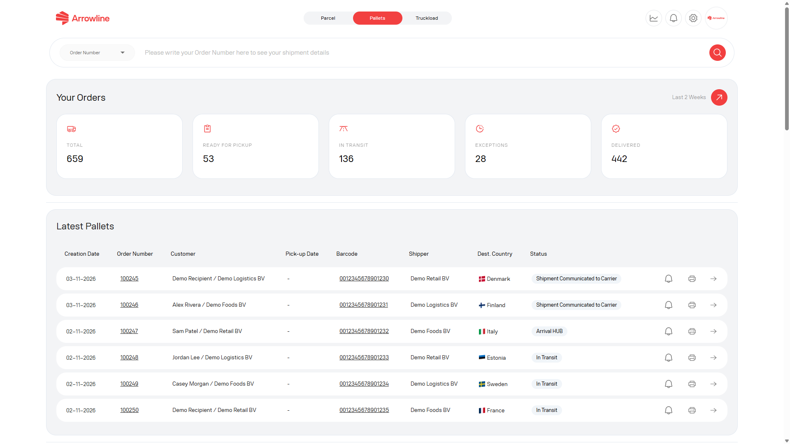
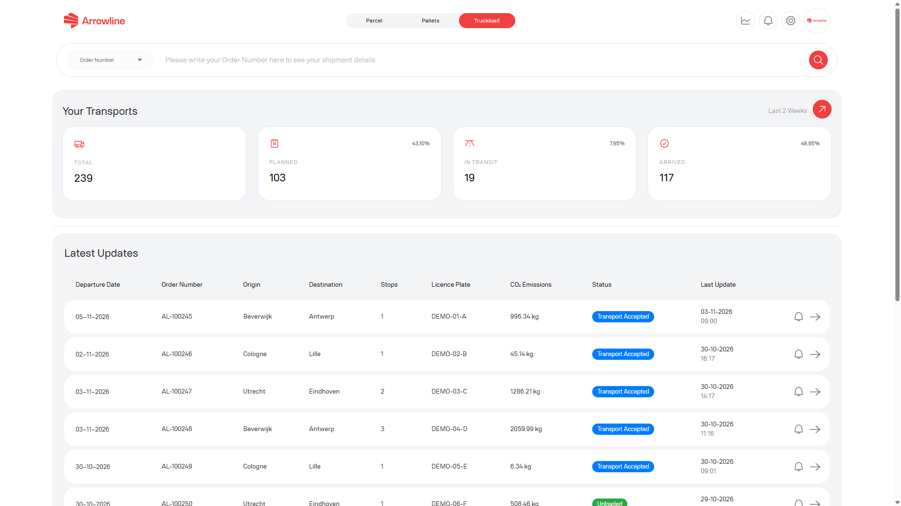

Jedes berechtigte Modul hat ein eigenes Dashboard. Daten von Pakete, Paletten und Komplettladungen sind nicht auf einem Bildschirm gemischt.

Nach der Anmeldung öffnet das Portal das erste berechtigte Modul. Von dort können Sie zu den anderen Modulen in der Kopfzeile wechseln.

<Frame caption="Beispielbild mit Dummy-Daten von Demo Logistics BV.">
  
</Frame>

## Dashboard von Pakete

Öffnen Sie **Pakete**, wenn Sie einen Überblick über die Paketaktivität brauchen. Das Dashboard kann zeigen:

- Sendungssummen nach operativem Status
- Die neuesten Paketsendungen
- Die neuesten Retouren
- Offene Claims in Pakete
- Offene Tickets in Pakete
- Eine Servicelevel-Zusammenfassung

Von hier können Sie die [Sendungsliste](/de/parcels/shipments), eine [Retoure](/de/parcels/returns), einen [Claim](/de/parcels/claims), ein [Ticket](/de/parcels/tickets) oder den [Performance-Bericht](/de/parcels/performance) öffnen, wenn dieser Eintrag angezeigt wird.

Die Sendungssummen nutzen ein aktuelles Fenster von zwei Wochen. Neueste Sendungen und neueste Retouren sind kurze Listen, nicht die vollständige Historie. Nutzen Sie [Sendungen in Pakete](/de/parcels/shipments), wenn Sie einen längeren Zeitraum durchsuchen müssen.

## Dashboard von Paletten

Öffnen Sie **Paletten**, wenn Sie einen Überblick über die Palettenaktivität brauchen. Das Paletten-Dashboard kann zeigen:

- Palettensummen für ein aktuelles Fenster von zwei Wochen
- Neueste Palettensendungen
- Incoming orders
- Claims in Paletten
- Tickets in Paletten
- Performance- und Länderergebnisse, sofern verfügbar

<Frame caption="Beispielbild mit Dummy-Daten von Demo Logistics BV.">
  
</Frame>

Von hier können Sie einen Auftrag öffnen, zu [Incoming orders](/de/pallets/incoming-orders) oder zur [Sendungsliste](/de/pallets/shipments) wechseln oder einen [Claim](/de/pallets/claims) oder ein [Ticket](/de/pallets/tickets) verfolgen.

Manche Administratorkonten können das Unternehmen auf dem Paletten-Dashboard ändern. Andere Benutzerinnen und Benutzer sehen nur ihr eigenes Unternehmen. Distributor-Konten können außerdem auf zulässige Bestimmungsländer beschränkt sein.

## Dashboard von Komplettladungen

Öffnen Sie **Komplettladungen**, wenn Sie einen Überblick über die Komplettladungsaktivität brauchen. Das Dashboard kann zeigen:

- Transportsummen für ein aktuelles Fenster von zwei Wochen
- Statuszahlen für Planned, In Transit und Arrived
- Neueste Transportaktualisierungen
- Die Performance eines Zeitraums im Vergleich zum gleichen Intervall im Vorjahr, wenn diese Ansicht angezeigt wird

<Frame caption="Beispielbild mit Dummy-Daten von Demo Logistics BV.">
  
</Frame>

Von hier können Sie einen [Transport](/de/truckloads/shipments) öffnen, zur [Sendungsliste](/de/truckloads/shipments) wechseln oder den [Performance-Bericht](/de/truckloads/performance) öffnen, wenn dieser Eintrag angezeigt wird.

## Kopfzeile und Account

Während Sie angemeldet sind, kann die Kopfzeile zeigen:

- Die Module, die Ihr Unternehmen nutzen darf
- Eine Anzahl ungelesener Benachrichtigungen
- Zugang zu [Account](/de/start/account), wo Sie Unternehmensinformationen prüfen, Ihre Telefonnummer aktualisieren, Rechnungen oder Verträge öffnen können, sofern sie verfügbar sind, und sich abmelden

Nutzen Sie das Produkt, das zum Sendungstyp passt. Ein Claim oder Ticket aus Pakete erscheint nicht in Paletten oder Komplettladungen. Ein Palettenauftrag erscheint nicht in Pakete oder Komplettladungen. Eine Komplettladung erscheint nicht in Paketen oder Paletten.

<Tip>
  Wenn Sie eine bestimmte Sendung statt eines Überblicks brauchen, gehen Sie zu [Eine Sendung suchen](/de/portal/searching).
</Tip>
