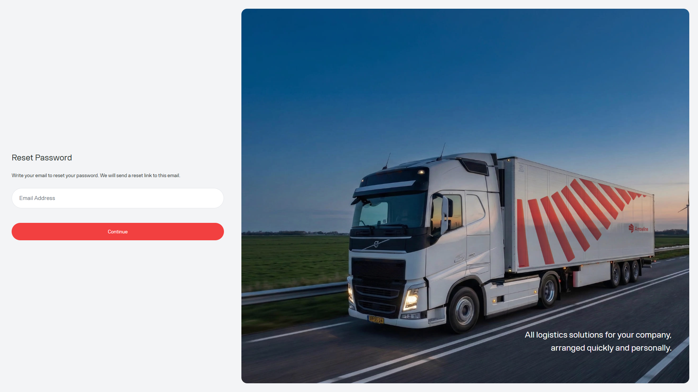

Nutzen Sie das Zurücksetzen des Passworts, wenn Sie sich nicht anmelden können und ein neues Portalpasswort brauchen. Der Ablauf hat drei Schritte: einen Reset anfordern, den Code aus der E-Mail eingeben und danach ein neues Passwort speichern.

<Frame caption="Beispielbild mit Dummy-Daten von Demo Logistics BV.">
  
</Frame>

## Passwort zurücksetzen

<Steps>
  <Step title="Öffnen Sie Forgot password">Wählen Sie auf der [Anmeldeseite](/de/start/sign-in) den Link Forgot password.</Step>
  <Step title="Geben Sie Ihre registrierte E-Mail-Adresse ein">Lassen Sie das Portal einen Reset-Code an diese Adresse senden.</Step>
  <Step title="Geben Sie den Reset-Code ein">Öffnen Sie die E-Mail und geben Sie den Code im Prüfschritt ein. Der Code ist eine Stunde gültig.</Step>
  <Step title="Wählen Sie ein neues Passwort">Geben Sie das neue Passwort zweimal ein. Es muss die Passwortregeln des Portals unten erfüllen.</Step>
  <Step title="Melden Sie sich erneut an">Nach einem erfolgreichen Reset kehrt das Portal zur Anmeldeseite zurück. Melden Sie sich mit dem neuen Passwort an.</Step>
</Steps>

<Frame caption="Beispielbild mit Dummy-Daten von Demo Logistics BV.">
  
</Frame>

## Passwortregeln

Ihr neues Passwort muss alles Folgende enthalten:

- Mindestens 8 Zeichen
- Einen Großbuchstaben
- Einen Kleinbuchstaben
- Eine Zahl
- Ein erlaubtes Sonderzeichen: `! @ # $ % ^ & * ) ( + = . _ -`

Die beiden Passwortfelder müssen übereinstimmen, bevor Sie das neue Passwort speichern können.

<Warning>
  Senden Sie Ihr Passwort, Ihren Reset-Code oder einen Screenshot der E-Mail-Prüfung nicht an Support. Wenn der Code abgelaufen ist, starten Sie den Reset erneut von der Anmeldeseite.
</Warning>

## Wenn der Reset nicht funktioniert

1. Prüfen Sie, ob Sie die E-Mail-Adresse verwenden, die für das Portal registriert ist.
2. Prüfen Sie Spam- oder Junk-Ordner auf die Reset-E-Mail.
3. Fordern Sie einen neuen Code an, wenn mehr als eine Stunde vergangen ist.
4. Folgen Sie [Ich kann mich nicht anmelden](/de/support/cannot-sign-in), wenn Sie weiterhin keinen Zugang zum Portal haben.
