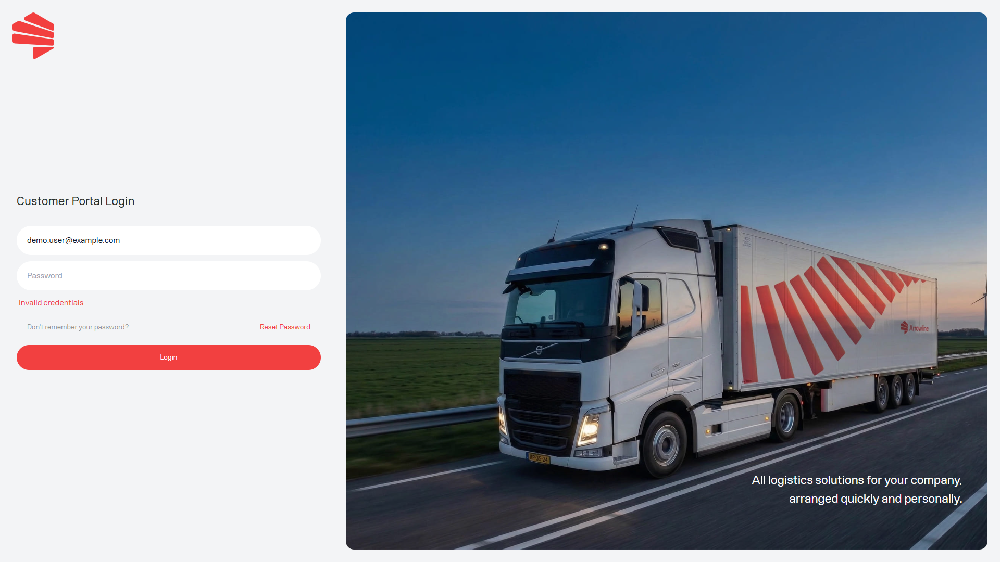

<Frame caption="Beispielbild mit Dummy-Daten von Demo Logistics BV.">
  
</Frame>

## Prüfen Sie diese Punkte

1. Prüfen Sie, ob Sie die E-Mail-Adresse verwenden, die für das Portal registriert ist.
2. Geben Sie Ihr Passwort sorgfältig erneut ein. Wenn die Anmeldung fehlschlägt, teilt das Portal nicht mit, ob die E-Mail-Adresse existiert.
3. Nutzen Sie [Passwort zurücksetzen](/de/start/password-reset), wenn Sie Ihr Passwort vergessen haben.
4. Prüfen Sie nach einer erfolgreichen Anmeldung [Wählen Sie Ihren Arbeitsablauf](/de/start/choose-your-workflow). Sie sehen nur die Module, die Ihrem Unternehmen zugeordnet sind.
5. Wenn Sie sich anmelden können, aber Pakete oder Paletten fehlt, bitten Sie Ihre Portaladministratorin bzw. Ihren Portaladministrator, die Unternehmensmodule zu prüfen.

Wenn der Zugriff weiterhin nicht verfügbar ist, kontaktieren Sie Support mit der E-Mail-Adresse, mit der Sie sich anmelden. Senden Sie niemals das Passwort oder den Reset-Code.

<Warning>
  Ein gespeicherter Link öffnet kein Modul, das für Ihr Konto nicht verfügbar ist.
</Warning>
