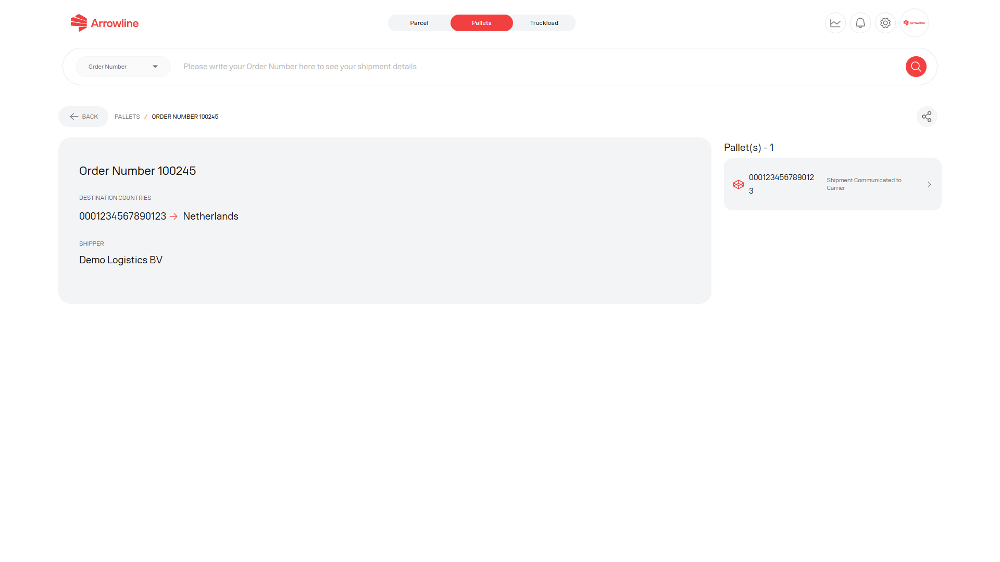

La página del pedido es la vista con sesión iniciada de un pedido de Palets. Está limitada a su empresa y, para las cuentas de distribuidor, a los países de destino permitidos.

<Frame caption="Imagen de ejemplo con datos ficticios de Demo Logistics BV.">
  
</Frame>

## Qué puede mostrar la página del pedido

- Número de pedido y datos del pedido
- Códigos de barras del envío
- Destino e información de entrega
- Entrega prevista, cuando esté disponible para un código de barras
- Transportista y volumen, cuando estén disponibles
- Un ticket de soporte vinculado, cuando exista uno para el pedido

Abra un código de barras para continuar a [Detalles del paquete de Palets](/es/pallets/package-detail). Use la página del paquete cuando necesite la línea de tiempo de estados de ese código de barras.

<Warning>
  Confirme el número de pedido y el destino antes de crear una reclamación o un ticket. Si falta un valor, trátelo como no disponible. No lo adivine.
</Warning>

## Páginas relacionadas de Palets

| Si necesita | Abra |
| --- | --- |
| Todos los envíos actuales | [Envíos de Palets](/es/pallets/shipments) |
| La línea de tiempo de un código de barras | [Detalles del paquete de Palets](/es/pallets/package-detail) |
| Datos de entrega o de entrega prevista | [Comprobante de entrega](/es/pallets/proof-of-delivery) |
| Un incidente formal | [Reclamaciones de Palets](/es/pallets/claims) |
| Una investigación | [Tickets de Palets](/es/pallets/tickets) |
