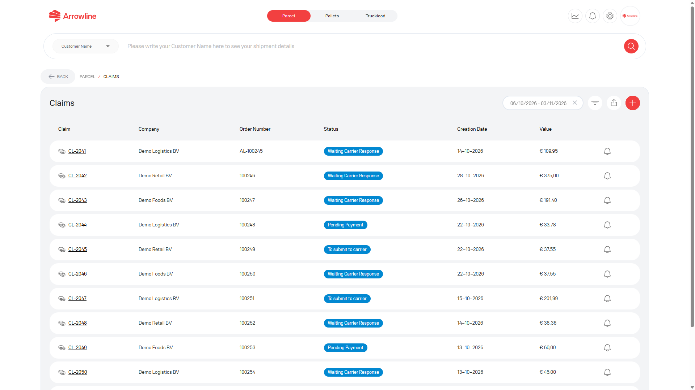
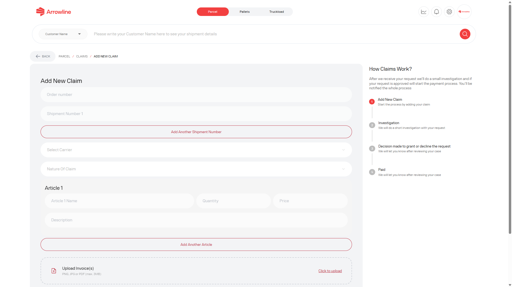
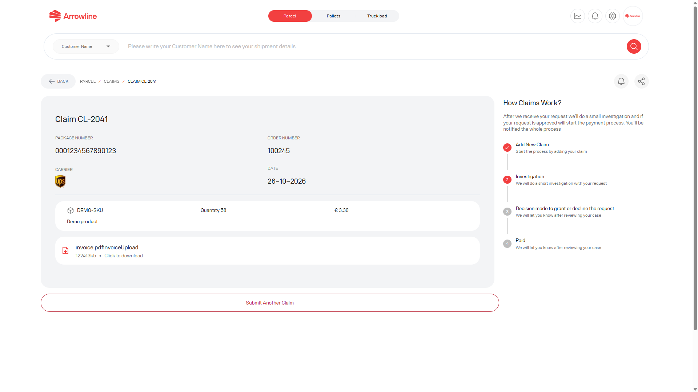

Use una reclamación de Paquetes para un incidente formal como daño, faltante o pérdida. Una reclamación es independiente del estado de seguimiento e independiente de un ticket de soporte.

<Frame caption="Imagen de ejemplo con datos ficticios de Demo Logistics BV.">
  
</Frame>

## Revise las reclamaciones existentes

La lista de reclamaciones muestra las reclamaciones de su empresa. Empieza con un rango de fechas de cuatro semanas.

Puede:

- Filtrar por estado, fecha o empresa
- Exportar la lista filtrada
- Abrir el resultado de una reclamación
- Activar o desactivar las notificaciones de reclamación
- Iniciar una reclamación nueva

Cada fila puede mostrar un identificador de reclamación, el pedido vinculado cuando está almacenado, la categoría, el estado y las fechas. Si falta una referencia de pedido, trátela como no disponible. No la adivine.

## Cree una reclamación

<Steps>
  <Step title="Abra las reclamaciones de Paquetes">Desde el espacio de trabajo de Paquetes, abra Claims e inicie una reclamación nueva.</Step>
  <Step title="Introduzca el envío">Añada el número de pedido y cada número de paquete. Elija el transportista y la naturaleza de la reclamación.</Step>
  <Step title="Añada los artículos">Por cada artículo, introduzca el nombre, la cantidad, el precio y una descripción del problema.</Step>
  <Step title="Adjunte los archivos obligatorios">Añada la factura. Añada fotos salvo que la naturaleza de la reclamación sea lost. Añada una lista de empaque cuando el transportista sea Van Duuren.</Step>
  <Step title="Compruebe el total">El portal multiplica cantidad × precio de cada artículo para mostrar el valor de la reclamación.</Step>
  <Step title="Envíe una sola vez">Envíe el formulario y espere la página de resultado de la reclamación. No envíe la misma reclamación otra vez.</Step>
</Steps>

<Frame caption="Imagen de ejemplo con datos ficticios de Demo Logistics BV.">
  
</Frame>

El formulario no se enviará hasta que los campos obligatorios estén completos.

## Después de enviar

La página de resultado de la reclamación muestra el estado del caso, el progreso, el pedido y el transportista vinculados cuando están disponibles, los comentarios y los adjuntos, y un control de notificaciones.

<Frame caption="Imagen de ejemplo con datos ficticios de Demo Logistics BV.">
  
</Frame>

Use el control de notificaciones si desea actualizaciones de estado. Responda en esta reclamación si Support pide más información.

<Warning>
  No cree una segunda reclamación para el mismo paquete salvo que Arrowline Support se lo pida. Un estado de seguimiento Delivered puede tener aún una reclamación abierta.
</Warning>
