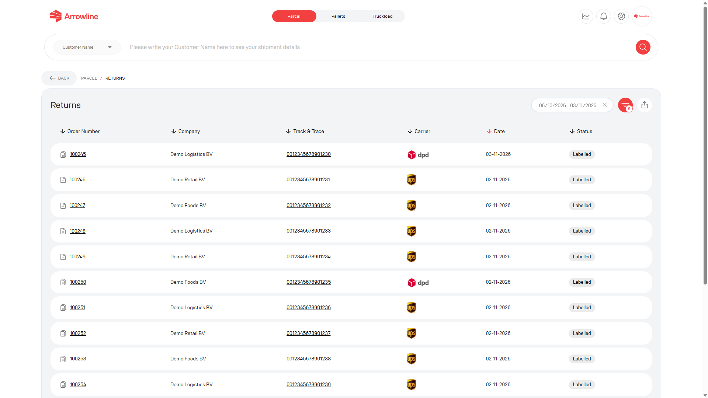
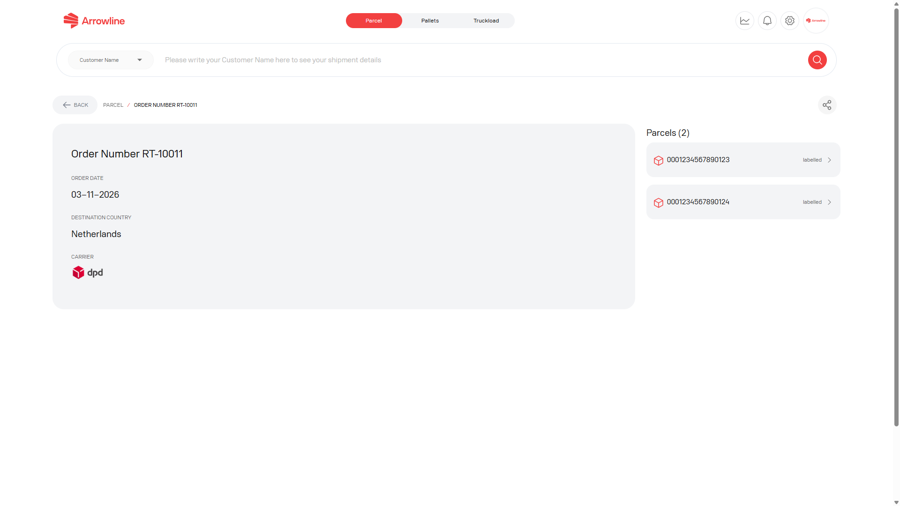
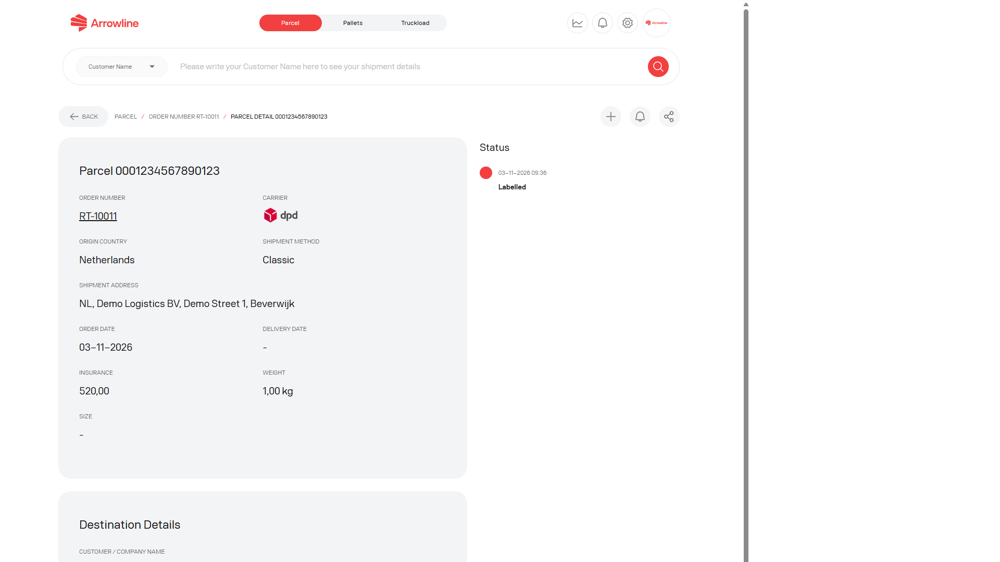

Les retours sont des enregistrements de logistique inverse. Ils ont leur propre liste et ne sont pas mélangés aux [expéditions Colis](/fr/parcels/shipments).

<Frame caption="Image exemple avec des donnees fictives de Demo Logistics BV.">
  
</Frame>

## Trouver un retour

<Steps>
  <Step title="Ouvrez Colis">Connectez-vous et ouvrez l'espace de travail Colis.</Step>
  <Step title="Ouvrez Returns">Utilisez la liste des retours, ou ouvrez un retour depuis le tableau de bord Colis.</Step>
  <Step title="Définissez les filtres">Utilisez les filtres de date et de retour affichés sur la page.</Step>
  <Step title="Ouvrez le retour">Sélectionnez le retour qui correspond à la commande ou au colis dont vous avez besoin.</Step>
</Steps>

La liste peut afficher des identifiants de retour, des valeurs de commande ou de colis liées, des badges de statut et des dates. Un lien manquant est affiché comme indisponible. Ne traitez pas un identifiant de retour comme un numéro d'expédition sortante.

## Détail du retour

La page de détail du retour est la vue au niveau de la commande. Elle peut afficher :

- Les informations de commande de retour
- Les liens vers les colis du retour
- Un avertissement ou un lien lorsqu'un ticket de support est déjà connecté

<Frame caption="Image exemple avec des donnees fictives de Demo Logistics BV.">
  
</Frame>

Ouvrez un colis lorsque vous avez besoin de l'enregistrement au niveau du code-barres. Ouvrez le ticket lié lorsque Support est déjà impliqué.

## Détail du colis de retour

La page colis peut afficher les informations du colis, la chronologie des événements, les notifications de statut et tout ticket lié.

<Frame caption="Image exemple avec des donnees fictives de Demo Logistics BV.">
  
</Frame>

Des événements de collecte ou de réception manquants ne signifient pas que le retour est terminé. Lisez les événements présents, puis attendez la prochaine mise à jour ou [créez un ticket Colis](/fr/parcels/tickets) si le retour nécessite une enquête.

<Info>
  Vous pouvez activer ou désactiver les notifications de statut depuis la page du colis de retour lorsque ce contrôle est affiché.
</Info>
