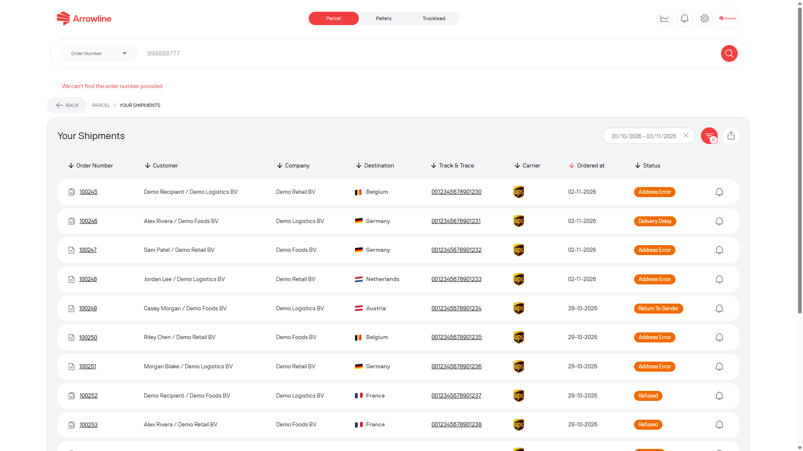

<Frame caption="Image exemple avec des donnees fictives de Demo Logistics BV.">
  
</Frame>

## Vérifiez ces points

1. Confirmez que vous êtes dans **Colis**, **Palettes** ou **Chargements complets**, et non dans un autre espace de travail.
2. Recherchez avec le numéro de commande complet.
3. Pour les palettes, recherchez aussi avec le code-barres ou le numéro de suivi complet.
4. Pour un chargement complet, vérifiez aussi l'origine, la destination et la plaque d'immatriculation.
5. Sur les [expéditions Colis](/fr/parcels/shipments) ou les [expéditions Chargements complets](/fr/truckloads/shipments), élargissez la plage de dates.
6. Pour un retour, utilisez [Retours Colis](/fr/parcels/returns). Les retours ne sont pas dans la liste sortante.
7. Pour une commande palette non confirmée, vérifiez [Incoming orders](/fr/pallets/incoming-orders).
8. Si vous avez seulement besoin de l'avancement d'une palette, essayez le [suivi public des palettes](/fr/pallets/public-tracking).

Si l'enregistrement manque toujours, rassemblez le type de produit, le numéro de commande et tout code-barres, numéro de suivi ou plaque d'immatriculation. Pour Colis ou Palettes, créez un seul ticket. Pour Chargements complets, [contactez Support](/fr/support/contact). Voir [Informations dont Support a besoin](/fr/support/required-information).
