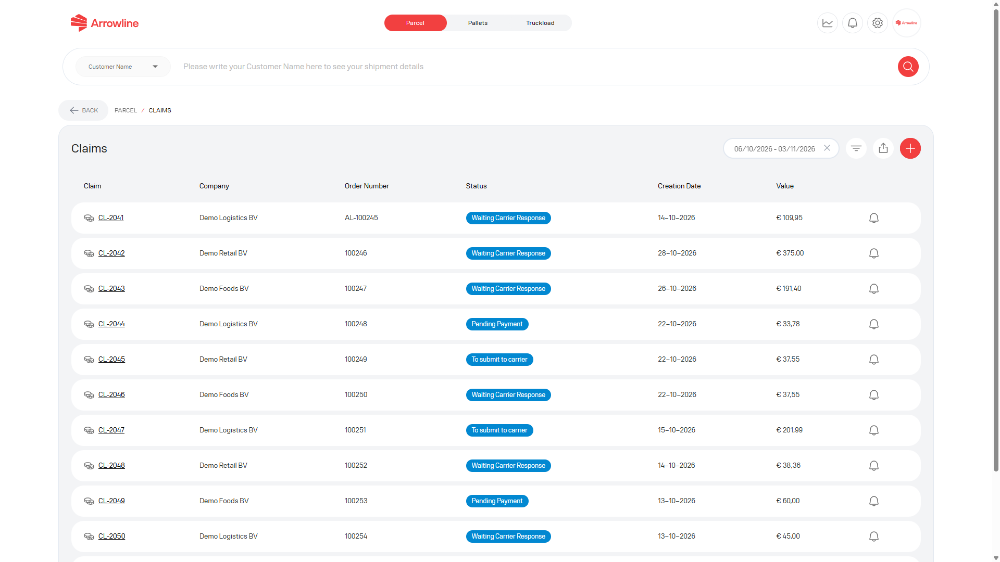
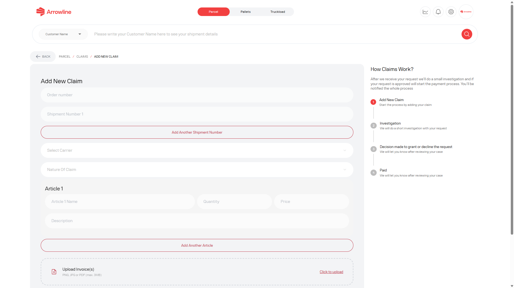
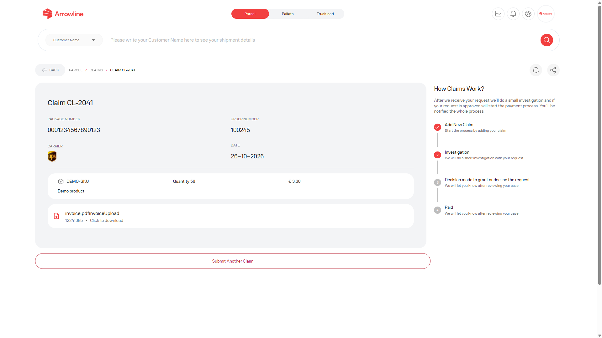

Gebruik een claim in Pallets voor een formeel incident zoals schade, tekort of vermissing. Een claim staat los van de trackingstatus en los van een supportticket.

<Frame caption="Voorbeeldafbeelding met dummygegevens van Demo Logistics BV.">
  
</Frame>

## Bestaande claims bekijken

De claimlijst van Pallets is niet de claimlijst van Pakketten. Die toont palletzaken van uw bedrijf.

U kunt:

- Filteren op datum, status of bedrijf
- De gefilterde lijst exporteren
- Een claimresultaat openen
- Claimmeldingen in- of uitschakelen
- Een nieuwe claim starten

Elke rij kan een claimreferentie, de gekoppelde order of barcode wanneer die is opgeslagen, type, status en datums tonen. Als een referentie ontbreekt, behandel die als niet beschikbaar.

## Een claim aanmaken

<Steps>
  <Step title="Open Claims in Pallets">Open vanuit de werkruimte Pallets Claims en start een nieuwe claim.</Step>
  <Step title="Vul de zending in">Voeg het ordernummer en elke barcode toe. Kies de vervoerder en de aard van de claim. De vervoerderslijst bevat Van Duuren, Geodis en CTS.</Step>
  <Step title="Voeg de artikelen toe">Vul voor elk artikel de naam, het aantal, de prijs en een beschrijving van het probleem in.</Step>
  <Step title="Voeg de verplichte bestanden toe">Voeg de factuur toe. Voeg foto's toe, tenzij de aard van de claim lost is.</Step>
  <Step title="Controleer het totaal">Het portaal telt aantal × prijs per artikel op om de claimwaarde te tonen.</Step>
  <Step title="Verzend één keer">Wacht op de resultaatpagina van de claim. Stuur dezelfde claim niet opnieuw.</Step>
</Steps>

<Frame caption="Voorbeeldafbeelding met dummygegevens van Demo Logistics BV.">
  
</Frame>

Het formulier wordt pas verzonden als de verplichte velden compleet zijn.

## Nadat u heeft verzonden

De resultaatpagina van de claim toont de zaakstatus, de voortgang, de gekoppelde order, barcode en vervoerder wanneer beschikbaar, opmerkingen en bijlagen, en een meldingsbediening.

<Frame caption="Voorbeeldafbeelding met dummygegevens van Demo Logistics BV.">
  
</Frame>

<Warning>
  Maak geen tweede claim in Pallets aan voor dezelfde barcodes, tenzij Support u dat vraagt. Een trackingstatus Delivered kan nog steeds een open claim hebben.
</Warning>
