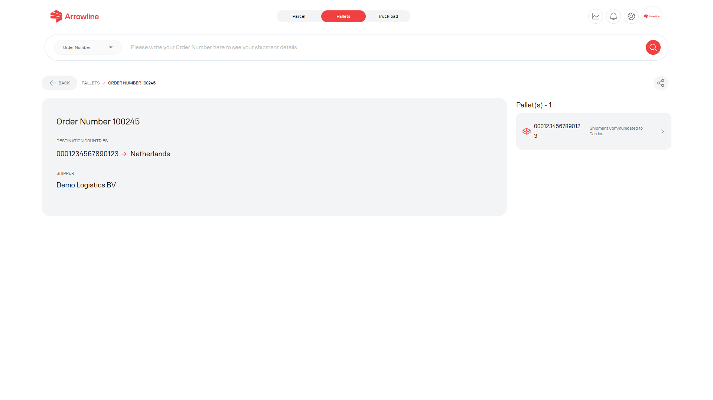

De orderpagina is de ingelogde weergave van één palletorder. Die is beperkt tot uw bedrijf en, voor distributeuraccounts, toegestane bestemmingslanden.

<Frame caption="Voorbeeldafbeelding met dummygegevens van Demo Logistics BV.">
  
</Frame>

## Wat de orderpagina kan tonen

- Ordernummer en ordergegevens
- Barcodes in de zending
- Bestemmings- en leveringsinformatie
- Verwachte levering, wanneer beschikbaar voor een barcode
- Vervoerder en volume, wanneer beschikbaar
- Een gekoppeld supportticket, wanneer er een bestaat voor de order

Open een barcode om door te gaan naar [Palletdetails](/nl/pallets/package-detail). Gebruik de pakketpagina wanneer u de statustijdlijn voor die barcode nodig heeft.

<Warning>
  Controleer het ordernummer en de bestemming voordat u een claim of ticket aanmaakt. Als een waarde ontbreekt, behandel die als niet beschikbaar. Raad die niet.
</Warning>

## Gerelateerde pagina's in Pallets

| Als u nodig heeft | Open |
| --- | --- |
| Alle huidige zendingen | [Palletzendingen](/nl/pallets/shipments) |
| De tijdlijn van één barcode | [Palletdetails](/nl/pallets/package-detail) |
| Feiten over levering of verwachte levering | [Leveringsbewijs](/nl/pallets/proof-of-delivery) |
| Een formeel incident | [Claims in Pallets](/nl/pallets/claims) |
| Een onderzoek | [Tickets in Pallets](/nl/pallets/tickets) |
