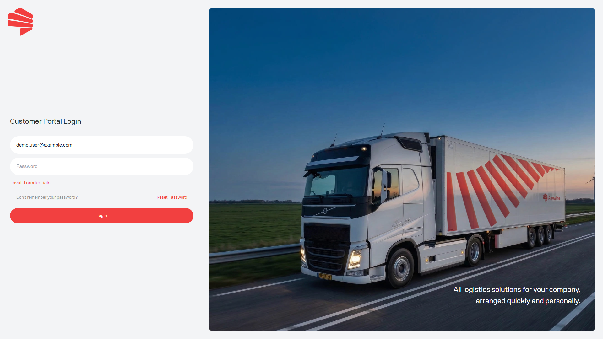

<Frame caption="Voorbeeldafbeelding met dummygegevens van Demo Logistics BV.">
  
</Frame>

## Controleer deze punten

1. Controleer of u het e-mailadres gebruikt dat voor het portaal is geregistreerd.
2. Vul uw wachtwoord zorgvuldig opnieuw in. Als het inloggen mislukt, laat het portaal niet zien of het e-mailadres bestaat.
3. Gebruik [Uw wachtwoord opnieuw instellen](/nl/start/password-reset) als u uw wachtwoord bent vergeten.
4. Controleer na een geslaagde aanmelding [Kies uw werkwijze](/nl/start/choose-your-workflow). U ziet alleen de modules die aan uw bedrijf zijn toegewezen.
5. Als u wel kunt inloggen maar Pakketten of Pallets ontbreekt, vraag uw portaalbeheerder om de bedrijfsmodules te controleren.

Als toegang nog steeds niet beschikbaar is, neem contact op met Support en geef het e-mailadres waarmee u inlogt. Stuur nooit het wachtwoord of de resetcode.

<Warning>
  Een opgeslagen link opent geen module die niet beschikbaar is voor uw account.
</Warning>
