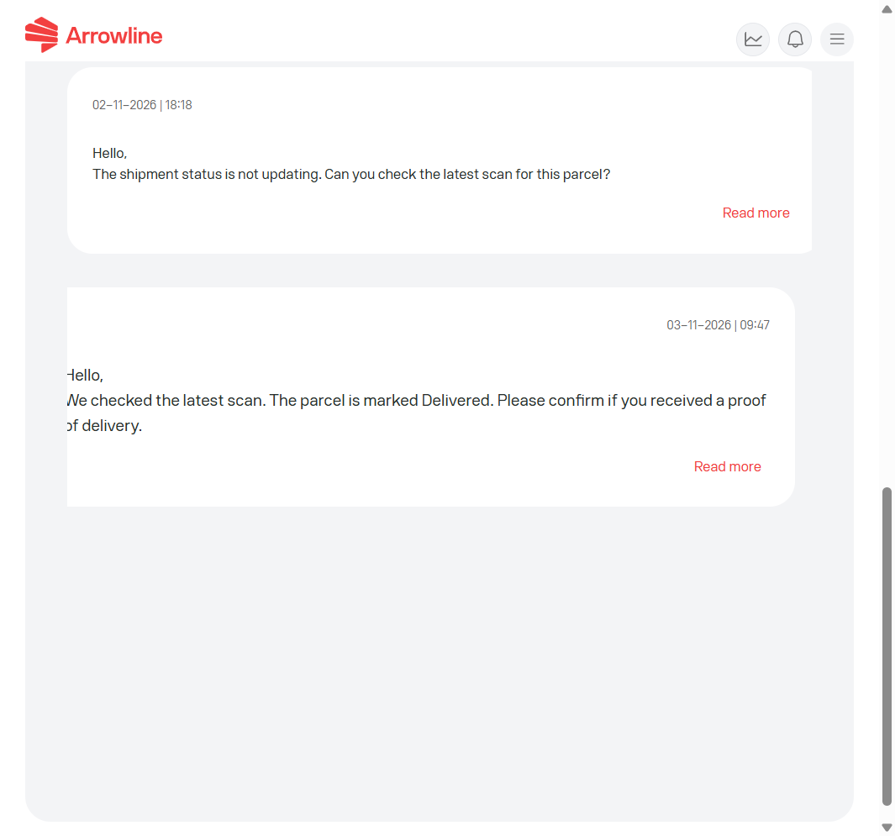

Open de ticketlijst in dezelfde werkruimte waar u het ticket heeft aangemaakt en selecteer daarna het ticket.

<Frame caption="Voorbeeldafbeelding met dummygegevens van Demo Logistics BV.">
  
</Frame>

Het gesprek kan tonen:

- Tickethistorie
- Opmerkingen
- Bijlagen
- De gekoppelde zending, order of barcode wanneer die beschikbaar is

Reageer in dat gesprek. Open geen tweede ticket voor dezelfde barcodes.

Zie [Tickets in Pakketten](/nl/parcels/tickets) of [Tickets in Pallets](/nl/pallets/tickets).
