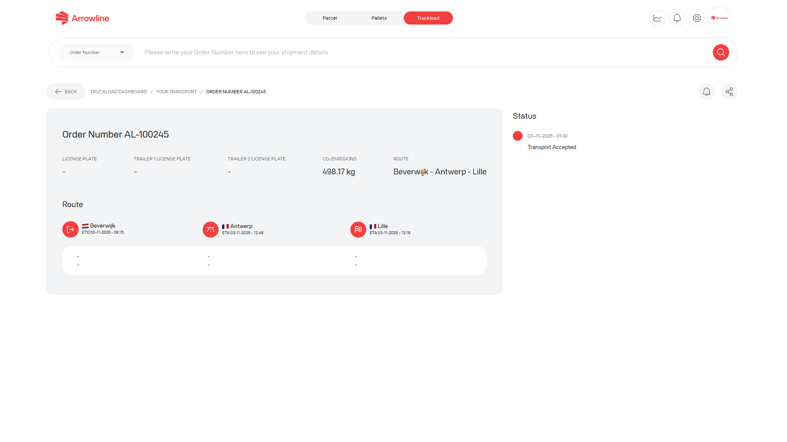

Open een transport vanuit de [zendingslijst van Complete ladingen](/nl/truckloads/shipments) wanneer u meer nodig heeft dan de rij in de lijst.

<Frame caption="Voorbeeldafbeelding met dummygegevens van Demo Logistics BV.">
  
</Frame>

## Wat u controleert

De detailpagina kan bevatten:

1. Transport- en ordergegevens
2. Herkomst, bestemming en stops
3. Aankomst- en vertrektijden
4. Voertuig- of vervoerdersgegevens wanneer het portaal die toont
5. Laatste status
6. Statusmeldingen voor dit transport

Gebruik alleen de informatie die het portaal toont. Als een veld voor voertuig, vervoerder of tijd leeg is, behandel dat als niet beschikbaar. Ga niet uit van een waarde van een andere zending.

## Gerelateerde pagina's in Complete ladingen

| Als u nodig heeft | Open |
| --- | --- |
| De werklijst | [Truckloadzendingen](/nl/truckloads/shipments) |
| Planned, In Transit of Arrived | [Statussen in Complete ladingen](/nl/truckloads/statuses) |
| Een resultaat over een periode, niet één transport | [Prestatierapport van Complete ladingen](/nl/truckloads/performance) |
| Hulp van Arrowline | [Contact met Arrowline Support](/nl/support/contact) |

<Tip>
  Bewaar het ordernummer, de herkomst, de bestemming en het kenteken voordat u contact opneemt met Support. Zie [Informatie die Support nodig heeft](/nl/support/required-information).
</Tip>
