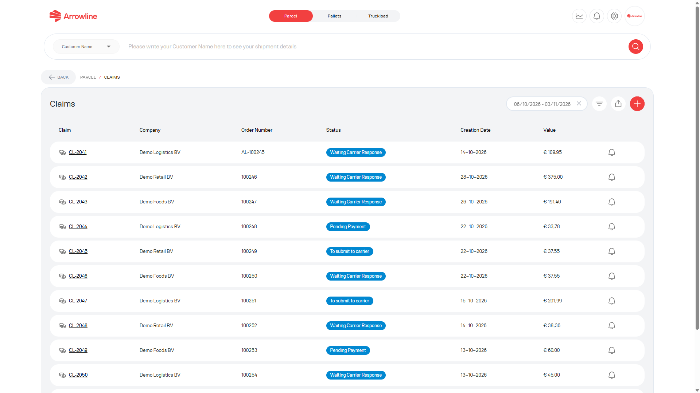
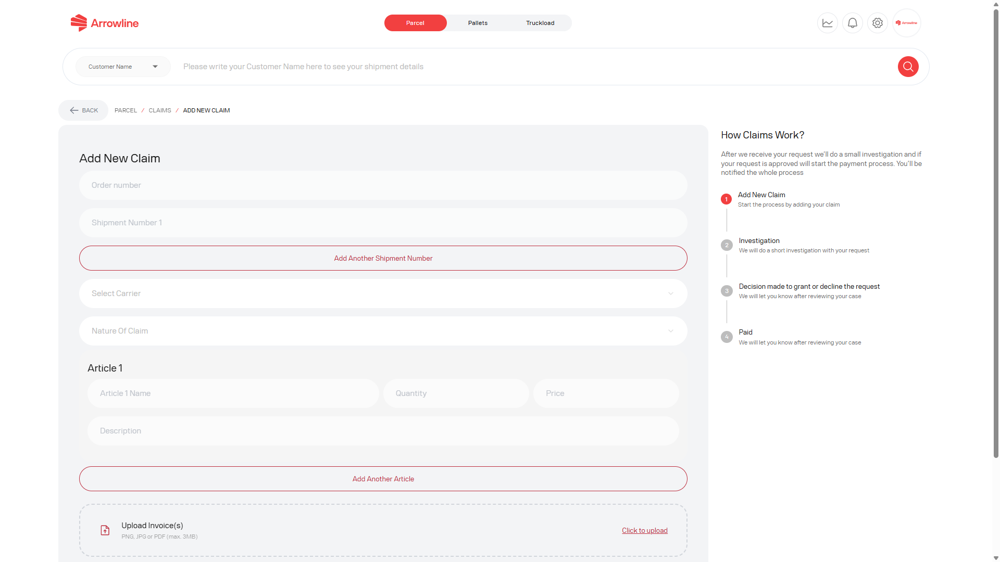
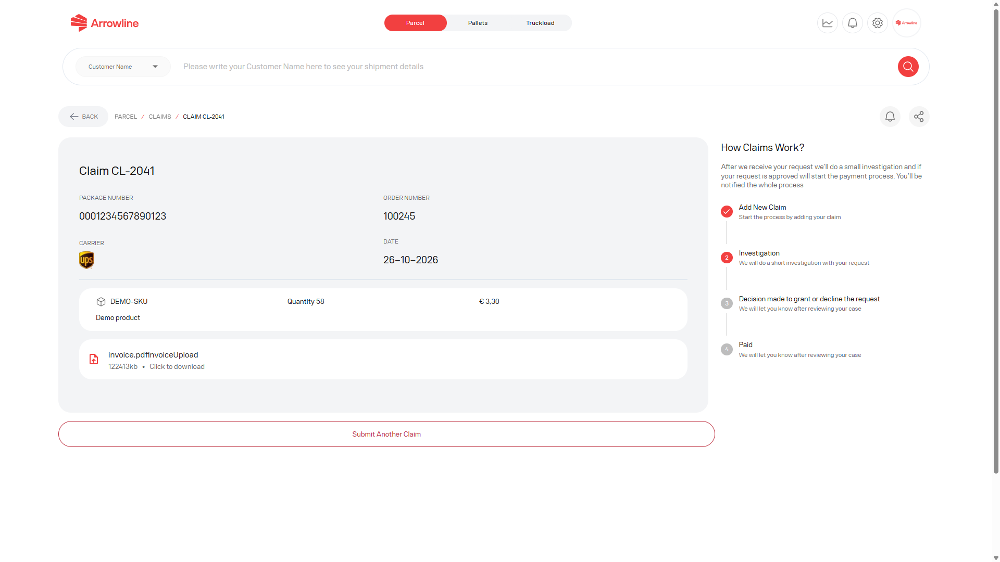

Use a pallet claim for a formal incident such as damage, shortage or loss. A claim is separate from the tracking status and separate from a support ticket.

<Frame caption="Parcel claims list with dummy claim numbers.">
  
</Frame>

## Review existing claims

The pallet claims list is not the parcel claims list. It shows pallet cases for your company.

You can:

- Filter by date, status or company
- Export the filtered list
- Open a claim result
- Turn claim notifications on or off
- Start a new claim

Each row can show a claim identifier, the linked order or barcode when it is stored, type, status and dates. If a reference is missing, treat it as unavailable.

## Create a claim

<Steps>
  <Step title="Open Pallet claims">From the Pallets workspace, open Claims and start a new claim.</Step>
  <Step title="Enter the shipment">Add the order number and each barcode. Choose the carrier and the claim nature. The carrier list includes Van Duuren, Geodis and CTS.</Step>
  <Step title="Add the articles">For every article, enter the name, quantity, price and a description of the issue.</Step>
  <Step title="Attach the required files">Add the invoice. Add pictures unless the claim nature is lost.</Step>
  <Step title="Check the total">The portal adds quantity × price for each article to show the claim value.</Step>
  <Step title="Submit once">Wait for the claim result page. Do not send the same claim again.</Step>
</Steps>

<Frame caption="Create-claim form. No real invoice is attached.">
  
</Frame>

The form will not submit until the required fields are complete.

## After you submit

The claim result page shows the case status, progress, linked order, barcode and carrier when available, comments and attachments, and a notification control.

<Frame caption="Claim result for dummy claim CL-2041.">
  
</Frame>

<Warning>
  Do not create a second pallet claim for the same barcodes unless Support asks you to. A delivered tracking status can still have an open claim.
</Warning>
