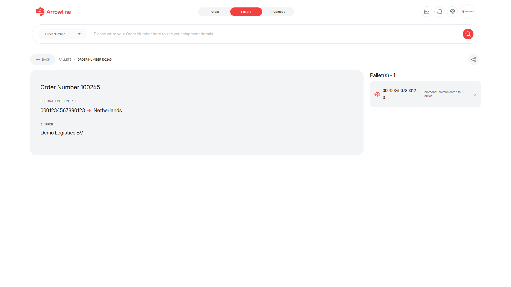

The order page is the signed-in view of one pallet order. It is limited to your company and, for distributor accounts, permitted destination countries.

<Frame caption="Pallet order AL-100245 with dummy destination data.">
  
</Frame>

## What the order page can show

- Order number and order data
- Barcodes in the shipment
- Destination and delivery information
- Expected delivery, when available for a barcode
- Carrier and volume, when available
- A linked support ticket, when one exists for the order

Open a barcode to continue to [Pallet details](/pallets/package-detail). Use the package page when you need the status timeline for that barcode.

<Warning>
  Confirm the order number and destination before you create a claim or ticket. If a value is missing, treat it as unavailable. Do not guess it.
</Warning>

## Related pallet pages

| If you need | Open |
| --- | --- |
| All current shipments | [Pallet shipments](/pallets/shipments) |
| One barcode timeline | [Pallet details](/pallets/package-detail) |
| Delivery or expected-delivery facts | [Proof of delivery](/pallets/proof-of-delivery) |
| A formal incident | [Pallet claims](/pallets/claims) |
| An investigation | [Pallet tickets](/pallets/tickets) |
