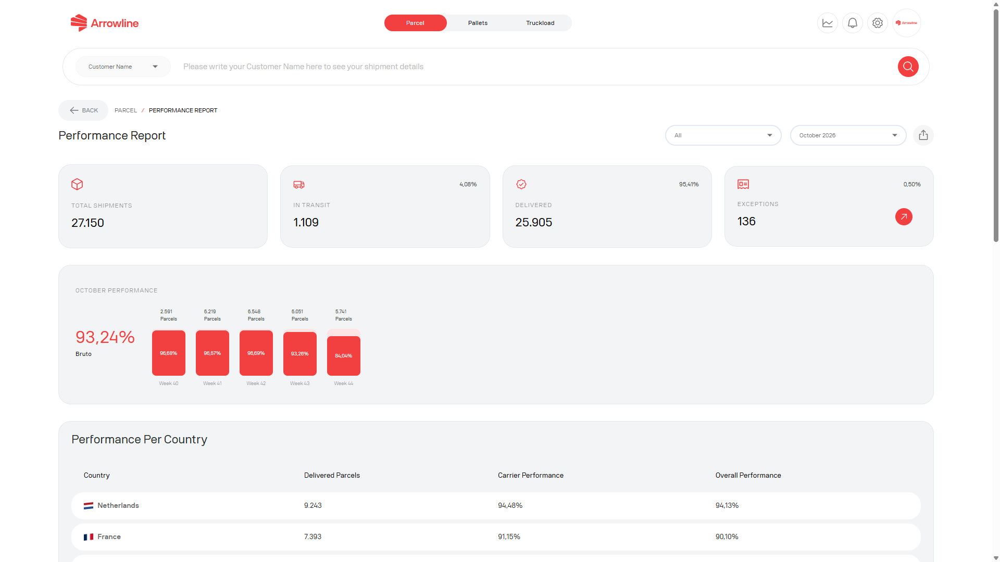

The parcel performance report is a signed-in Parcels page. It is for a reporting period, not for one shipment.

<Frame caption="Parcel performance report for a dummy period.">
  
</Frame>

## Open the report

<Steps>
  <Step title="Open Parcels">Sign in and open the Parcels workspace.</Step>
  <Step title="Open the performance report">Use the report from the Parcel dashboard when it is shown.</Step>
  <Step title="Choose the period">Set the date or month you want to review.</Step>
  <Step title="Read the results">Check the status totals, performance cards, chart and country table.</Step>
  <Step title="Download a PDF">Export the report that is on screen, including the selected period.</Step>
</Steps>

The report needs the Parcels module. If you cannot open it, your company may not have that page.

<Info>
  Use [Parcel shipments](/parcels/shipments) when you need an individual order. This report is for a period, not one parcel.
</Info>
