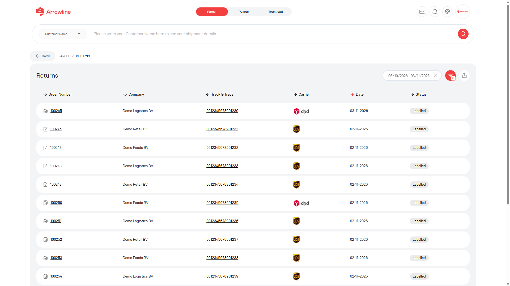
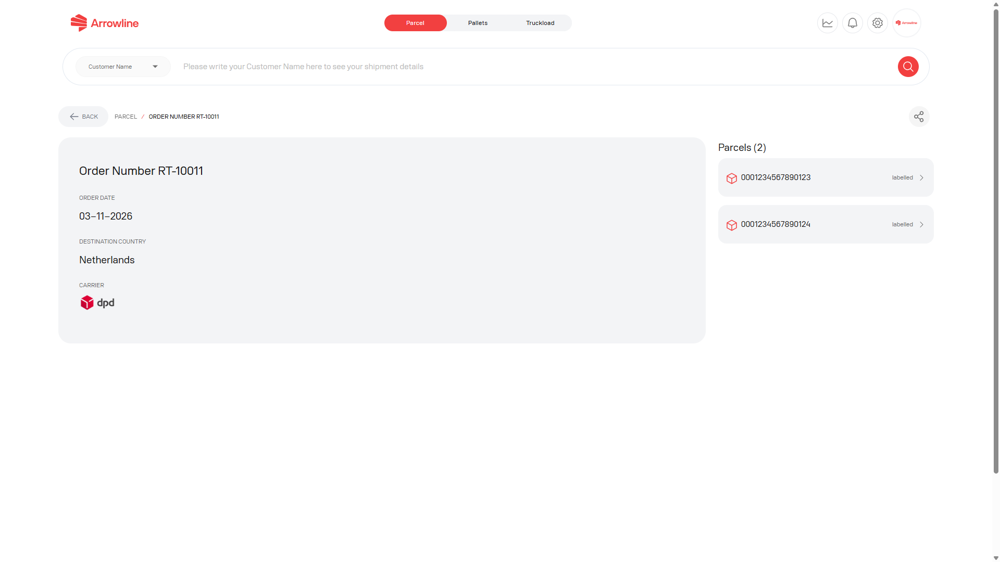
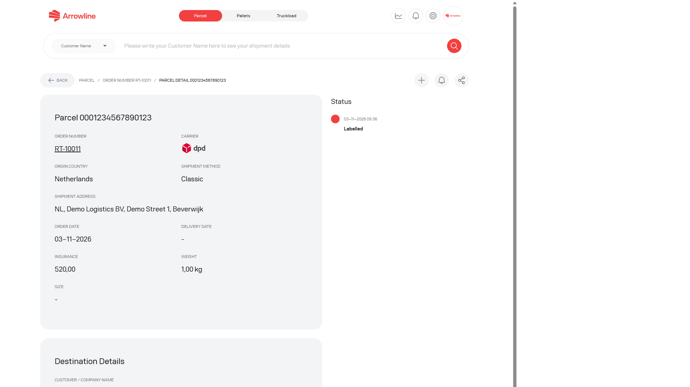

Returns are reverse-logistics records. They have their own list and are not mixed into [Parcel shipments](/parcels/shipments).

<Frame caption="Parcel returns list with dummy return numbers.">
  
</Frame>

## Find a return

<Steps>
  <Step title="Open Parcels">Sign in and open the Parcels workspace.</Step>
  <Step title="Open Returns">Use the returns list, or open a return from the Parcel dashboard.</Step>
  <Step title="Set the filters">Use the date and return filters shown on the page.</Step>
  <Step title="Open the return">Select the return that matches the order or package you need.</Step>
</Steps>

The list can show return identifiers, linked order or package values, status badges and dates. A missing link is shown as unavailable. Do not treat a return identifier as an outbound shipment number.

## Return detail

The return detail page is the order-level view. It can show:

- Return order facts
- Links to packages in the return
- A warning or link when a support ticket is already connected

<Frame caption="Return detail for dummy return RT-10011.">
  
</Frame>

Open a package when you need the barcode-level record. Open the linked ticket when Support is already involved.

## Return package detail

The package page can show package facts, the event timeline, status notifications and any linked ticket.

<Frame caption="Return package detail for dummy parcel 0001234567890123.">
  
</Frame>

Missing collection or receipt events do not mean the return is complete. Read the events that are present, then wait for the next update or [create a parcel ticket](/parcels/tickets) if the return needs investigation.

<Info>
  You can switch status notifications on or off from the return package page when that control is shown.
</Info>
