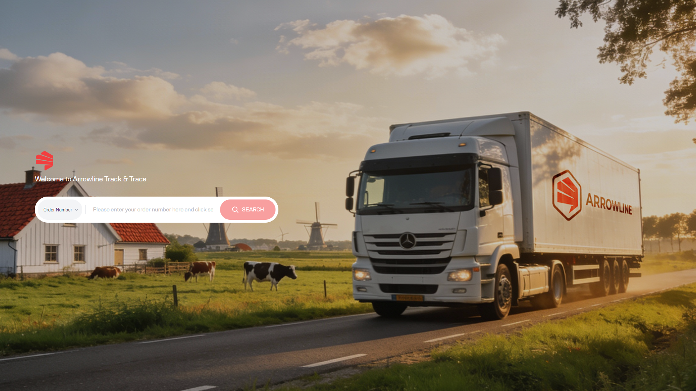
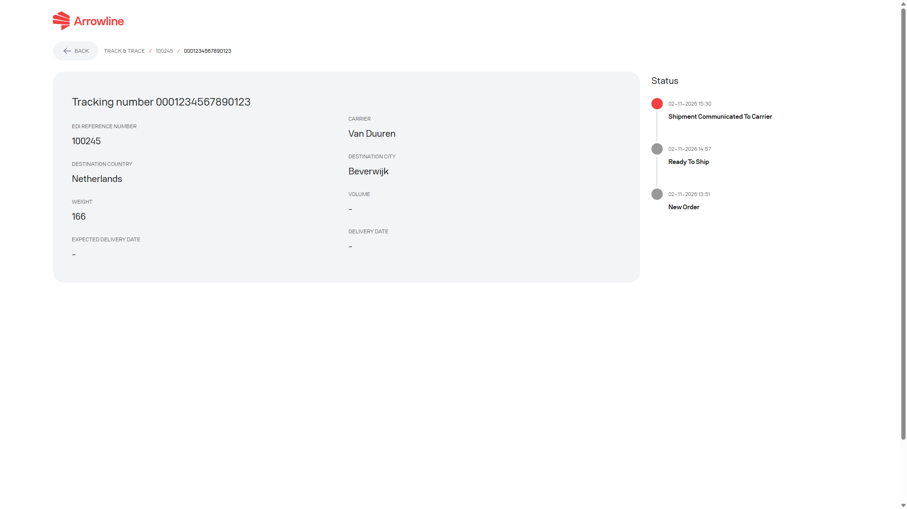

Publiczne śledzenie palet nie wymaga konta w portalu. Używać go, gdy mają Państwo numer zamówienia lub numer śledzenia i potrzebują wyłącznie zobaczyć postęp.

Ta strona dotyczy wyłącznie **Palety**. Nie znajdzie przesyłki paczka.

<Frame caption="Przykladowy zrzut z danymi testowymi Demo Logistics BV.">
  
</Frame>

## Wyszukać paletę

<Steps>
  <Step title="Otworzyć publiczne śledzenie">Przejść do publicznej strony śledzenia palet.</Step>
  <Step title="Wybrać typ wyszukiwania">Wybrać **Order Number** lub **Tracking Number**.</Step>
  <Step title="Wprowadzić pełny identyfikator">Wpisać pełną wartość. Nie skracać jej.</Step>
  <Step title="Wyszukać">Poczekać na wynik. Dopasowanie otwiera szczegóły śledzenia. Brak dopasowania pokazuje komunikat o nieznalezieniu.</Step>
</Steps>

Jeśli wyszukują Państwo po numerze zamówienia, a zamówienie ma więcej niż jeden kod kreskowy, portal otwiera pierwszy pasujący kod kreskowy. Na stronie szczegółów przełączyć kod kreskowy.

Współdzielony link śledzenia zawierający tylko jeden identyfikator jest rozpoznawany automatycznie. Jeśli nie da się go dopasować, portal wraca do strony wyszukiwania z komunikatem o nieznalezieniu.

## Odczytać szczegóły śledzenia

Publiczna strona szczegółów może pokazywać:

- Numer zamówienia i kod kreskowy
- Miejsce przeznaczenia
- Wagę
- Przewoźnika
- Oczekiwaną dostawę, gdy jest dostępna
- Zmapowaną oś czasu statusów

<Frame caption="Przykladowy zrzut z danymi testowymi Demo Logistics BV.">
  
</Frame>

Jeśli zamówienie ma kilka kodów kreskowych, użyć selektora kodu kreskowego, aby otworzyć inną paczkę w tym samym zamówieniu. Strona odświeża się mniej więcej co 30 sekund, dopóki pozostaje otwarta.

<Info>
  Oczekiwana dostawa jest pokazywana tylko wtedy, gdy portal ma tę informację dla kodu kreskowego. Jeśli jej brakuje, pozostałe szczegóły śledzenia nadal mogą być poprawne.
</Info>

## Kiedy potrzebny jest obszar roboczy po zalogowaniu

Zalogować się i używać obszaru roboczego Palety, gdy potrzebują Państwo:

- Planować lub potwierdzać [przychodzące zamówienia](/pl/pallets/incoming-orders)
- Pobrać etykietę wysyłkową
- Otworzyć [reklamację](/pl/pallets/claims) lub [zgłoszenie](/pl/pallets/tickets) paleta
- Przejrzeć [listę przesyłek](/pl/pallets/shipments) po zalogowaniu

Zobacz [Palety w portalu](/pl/pallets/overview) i [Nie można znaleźć przesyłki](/pl/support/shipment-not-found).
