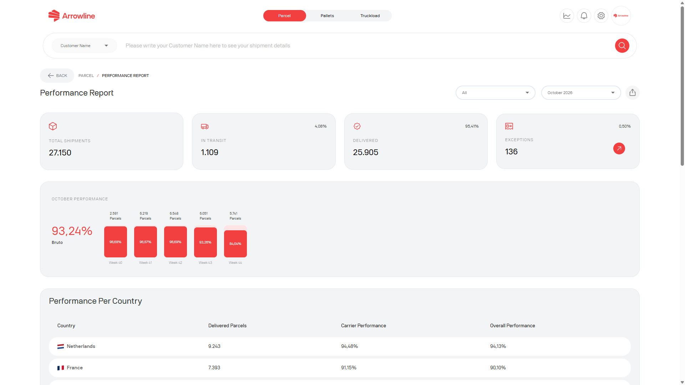

Raport wyników paczka to strona Paczki po zalogowaniu. Dotyczy okresu sprawozdawczego, a nie jednej przesyłki.

<Frame caption="Przykladowy zrzut z danymi testowymi Demo Logistics BV.">
  
</Frame>

## Otworzyć raport

<Steps>
  <Step title="Otworzyć Paczki">Zalogować się i otworzyć obszar roboczy Paczki.</Step>
  <Step title="Otworzyć raport wyników">Użyć raportu z pulpitu Paczka, gdy jest widoczny.</Step>
  <Step title="Wybrać okres">Ustawić datę lub miesiąc, który chcą Państwo przejrzeć.</Step>
  <Step title="Odczytać wyniki">Sprawdzić sumy statusów, karty wyników, wykres i tabelę krajów.</Step>
  <Step title="Pobrać plik PDF">Wyeksportować raport widoczny na ekranie, łącznie z wybranym okresem.</Step>
</Steps>

Raport wymaga modułu Paczki. Jeśli nie mogą Państwo go otworzyć, firma może nie mieć tej strony.

<Info>
  Użyć [Przesyłki Paczka](/pl/parcels/shipments), gdy potrzebują Państwo pojedynczego zamówienia. Ten raport dotyczy okresu, a nie jednej przesyłki paczka.
</Info>
