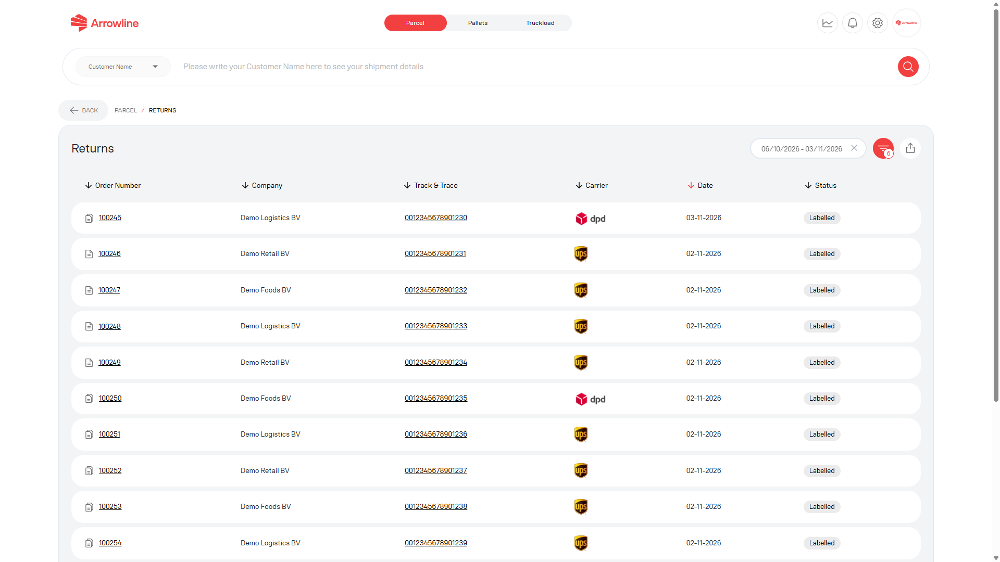
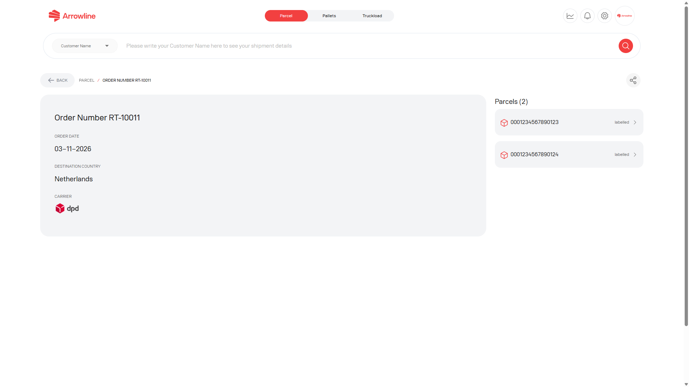
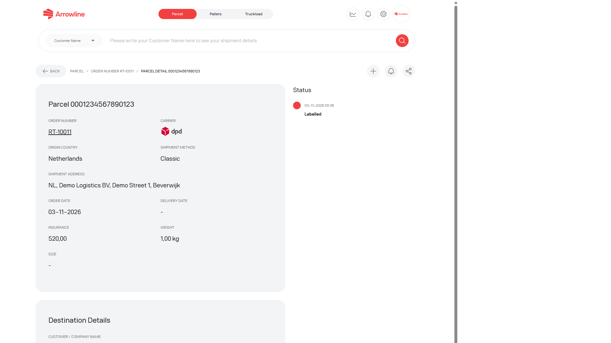

Zwroty to rekordy logistyki zwrotnej. Mają własną listę i nie są mieszane z [Przesyłkami Paczka](/pl/parcels/shipments).

<Frame caption="Przykladowy zrzut z danymi testowymi Demo Logistics BV.">
  
</Frame>

## Znaleźć zwrot

<Steps>
  <Step title="Otworzyć Paczki">Zalogować się i otworzyć obszar roboczy Paczki.</Step>
  <Step title="Otworzyć Returns">Użyć listy zwrotów albo otworzyć zwrot z pulpitu Paczka.</Step>
  <Step title="Ustawić filtry">Użyć filtrów daty i zwrotu widocznych na stronie.</Step>
  <Step title="Otworzyć zwrot">Wybrać zwrot pasujący do potrzebnego zamówienia lub paczki.</Step>
</Steps>

Lista może pokazywać identyfikatory zwrotów, powiązane wartości zamówienia lub paczki, oznaczenia statusu i daty. Brakujące powiązanie jest pokazywane jako niedostępne. Nie traktować identyfikatora zwrotu jako numeru wychodzącej przesyłki.

## Szczegóły zwrotu

Strona szczegółów zwrotu to widok na poziomie zamówienia. Może pokazywać:

- Dane zamówienia zwrotu
- Linki do paczek w zwrocie
- Ostrzeżenie lub link, gdy zgłoszenie wsparcia jest już powiązane

<Frame caption="Przykladowy zrzut z danymi testowymi Demo Logistics BV.">
  
</Frame>

Otworzyć paczkę, gdy potrzebują Państwo rekordu na poziomie kodu kreskowego. Otworzyć powiązane zgłoszenie, gdy Support jest już zaangażowany.

## Szczegóły paczki zwrotu

Strona paczki może pokazywać dane paczki, oś czasu zdarzeń, powiadomienia o statusie i ewentualne powiązane zgłoszenie.

<Frame caption="Przykladowy zrzut z danymi testowymi Demo Logistics BV.">
  
</Frame>

Brakujące zdarzenia odbioru lub przyjęcia nie oznaczają, że zwrot jest zakończony. Odczytać obecne zdarzenia, a następnie poczekać na następną aktualizację albo [utworzyć zgłoszenie paczka](/pl/parcels/tickets), jeśli zwrot wymaga wyjaśnienia.

<Info>
  Na stronie paczki zwrotu można włączać lub wyłączać powiadomienia o statusie, gdy ten element sterujący jest widoczny.
</Info>
