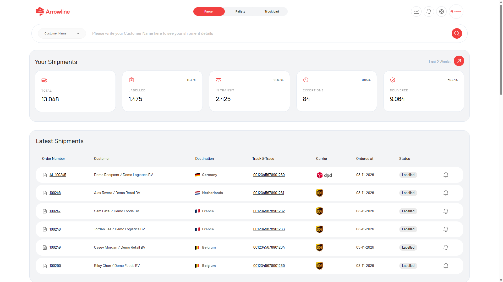
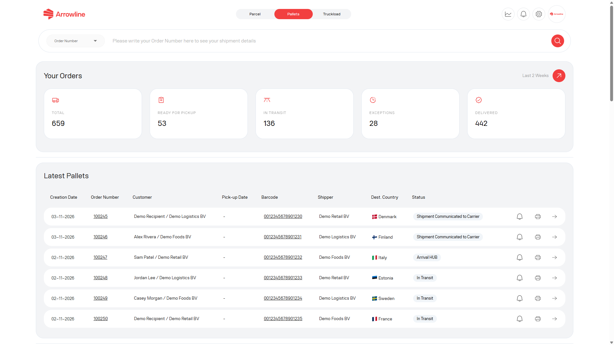
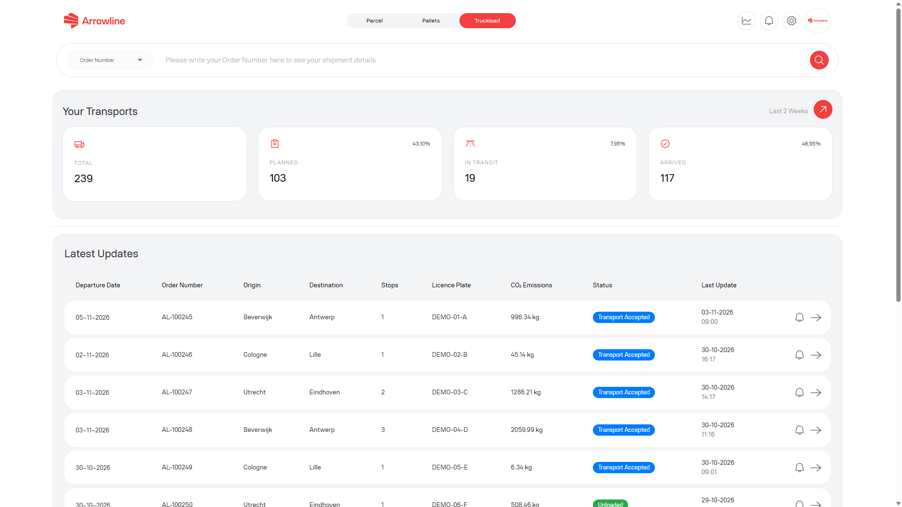

Każdy przysługujący moduł ma własny pulpit. Dane Paczki, Palety i Ładunki kompletne nie są mieszane na jednym ekranie.

Po zalogowaniu portal otwiera pierwszy przysługujący moduł. Stamtąd można przejść do pozostałych modułów pokazanych w nagłówku.

<Frame caption="Przykladowy zrzut z danymi testowymi Demo Logistics BV.">
  
</Frame>

## Pulpit Paczka

Otworzyć **Paczki**, gdy potrzebują Państwo przeglądu aktywności paczka. Pulpit może pokazywać:

- Sumy przesyłek według statusu operacyjnego
- Najnowsze przesyłki paczka
- Najnowsze zwroty
- Otwarte reklamacje paczka
- Otwarte zgłoszenia paczka
- Podsumowanie poziomu usług

Stąd można otworzyć [listę przesyłek](/pl/parcels/shipments), [zwrot](/pl/parcels/returns), [reklamację](/pl/parcels/claims), [zgłoszenie](/pl/parcels/tickets) lub [raport wyników](/pl/parcels/performance), gdy dany element jest widoczny.

Sumy przesyłek obejmują ostatnie dwa tygodnie. Najnowsze przesyłki i najnowsze zwroty to krótkie listy, a nie pełna historia. Użyć [Przesyłki Paczka](/pl/parcels/shipments), gdy potrzebują Państwo wyszukać dłuższy okres.

## Pulpit Paleta

Otworzyć **Palety**, gdy potrzebują Państwo przeglądu aktywności paleta. Pulpit paleta może pokazywać:

- Sumy paleta za ostatnie dwa tygodnie
- Najnowsze przesyłki paleta
- Przychodzące zamówienia
- Reklamacje paleta
- Zgłoszenia paleta
- Wyniki oraz rezultaty według kraju, gdy są dostępne

<Frame caption="Przykladowy zrzut z danymi testowymi Demo Logistics BV.">
  
</Frame>

Stąd można otworzyć zamówienie, przejść do [przychodzących zamówień](/pl/pallets/incoming-orders) lub [listy przesyłek](/pl/pallets/shipments) albo otworzyć [reklamację](/pl/pallets/claims) lub [zgłoszenie](/pl/pallets/tickets).

Niektóre konta administratora mogą zmienić firmę pokazywaną na pulpicie paleta. Pozostali użytkownicy widzą wyłącznie swoją firmę. Konta dystrybutorów mogą być dodatkowo ograniczone do dozwolonych krajów przeznaczenia.

## Pulpit Ładunki kompletne

Otworzyć **Ładunki kompletne**, gdy potrzebują Państwo przeglądu aktywności ładunek kompletny. Pulpit może pokazywać:

- Sumy transportów za ostatnie dwa tygodnie
- Liczniki statusów Planned, In Transit i Arrived
- Najnowsze aktualizacje transportów
- Wyniki za okres w porównaniu z tym samym przedziałem w poprzednim roku, gdy ten widok jest widoczny

<Frame caption="Przykladowy zrzut z danymi testowymi Demo Logistics BV.">
  
</Frame>

Stąd można otworzyć [transport](/pl/truckloads/shipments), przejść do [listy przesyłek](/pl/truckloads/shipments) albo otworzyć [raport wyników](/pl/truckloads/performance), gdy dany element jest widoczny.

## Nagłówek i konto

Gdy są Państwo zalogowani, nagłówek może pokazywać:

- Moduły, z których Państwa firma może korzystać
- Liczbę nieprzeczytanych powiadomień
- Dostęp do [Konta](/pl/start/account), gdzie można przejrzeć dane firmy, zaktualizować numer telefonu, otworzyć faktury lub umowy, gdy są dostępne, oraz wylogować się

Używać produktu odpowiadającego typowi przesyłki. Reklamacja lub zgłoszenie paczka nie pojawi się w Palety ani Ładunki kompletne. Zamówienie paleta nie pojawi się w Paczki ani Ładunki kompletne. Ładunek kompletny nie pojawi się w Paczki ani Palety.

<Tip>
  Jeśli potrzebują Państwo konkretnej przesyłki, a nie przeglądu, przejść do [Wyszukiwanie przesyłki](/pl/portal/searching).
</Tip>
