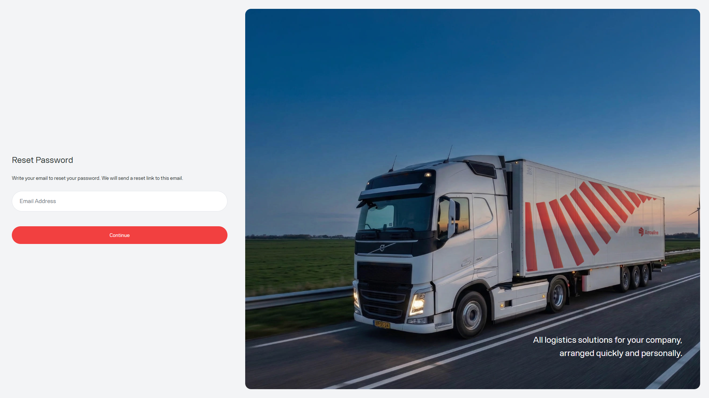

Użyć resetu hasła, gdy nie mogą Państwo się zalogować i potrzebują nowego hasła do portalu. Przebieg ma trzy kroki: poprosić o reset, wprowadzić kod z e-maila, a następnie zapisać nowe hasło.

<Frame caption="Przykladowy zrzut z danymi testowymi Demo Logistics BV.">
  
</Frame>

## Zresetować hasło

<Steps>
  <Step title="Otworzyć Forgot password">Na [stronie logowania](/pl/start/sign-in) wybrać link Forgot password.</Step>
  <Step title="Wprowadzić zarejestrowany adres e-mail">Poprosić portal o wysłanie kodu resetu na ten adres.</Step>
  <Step title="Wprowadzić kod resetu">Otworzyć e-mail i wpisać kod na etapie weryfikacji. Kod jest ważny przez godzinę.</Step>
  <Step title="Wybrać nowe hasło">Wprowadzić nowe hasło dwukrotnie. Musi spełniać poniższe reguły hasła portalu.</Step>
  <Step title="Zalogować się ponownie">Po udanym resecie portal wraca do strony logowania. Zalogować się nowym hasłem.</Step>
</Steps>

<Frame caption="Przykladowy zrzut z danymi testowymi Demo Logistics BV.">
  
</Frame>

## Reguły hasła

Nowe hasło musi zawierać wszystkie poniższe elementy:

- Co najmniej 8 znaków
- Jedną wielką literę
- Jedną małą literę
- Jedną cyfrę
- Jeden dozwolony znak specjalny: `! @ # $ % ^ & * ) ( + = . _ -`

Oba pola hasła muszą być zgodne, zanim będzie można zapisać nowe hasło.

<Warning>
  Nie wysyłać do Support hasła, kodu resetu ani zrzutu ekranu z weryfikacją e-mail. Jeśli kod wygasł, rozpocząć reset ponownie ze strony logowania.
</Warning>

## Jeśli reset nie działa

1. Potwierdzić, że używają Państwo adresu e-mail zarejestrowanego w portalu.
2. Sprawdzić foldery spam lub niechciane wiadomości pod kątem e-maila z resetem.
3. Poprosić o nowy kod, jeśli minęła więcej niż godzina.
4. Postępować zgodnie z [Nie mogę się zalogować](/pl/support/cannot-sign-in), jeśli nadal nie mają Państwo dostępu do portalu.
