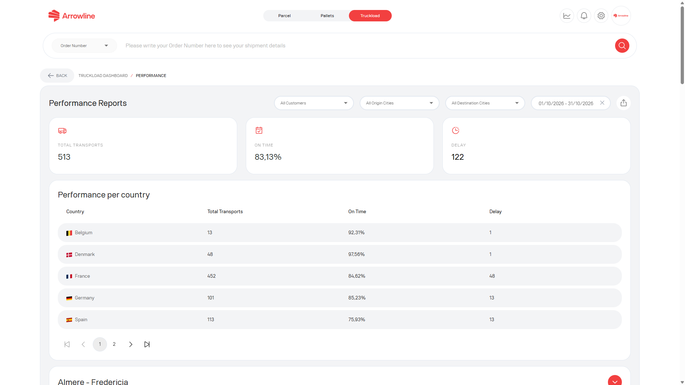

Raport wyników Ładunki kompletne to strona Ładunki kompletne po zalogowaniu. Dotyczy okresu sprawozdawczego, a nie jednego transportu.

<Frame caption="Przykladowy zrzut z danymi testowymi Demo Logistics BV.">
  
</Frame>

## Otworzyć raport

<Steps>
  <Step title="Otworzyć Ładunki kompletne">Zalogować się i otworzyć obszar roboczy Ładunki kompletne.</Step>
  <Step title="Otworzyć raport wyników">Użyć raportu z pulpitu Ładunki kompletne, gdy jest widoczny.</Step>
  <Step title="Wybrać okres">Ustawić zakres dat, który chcą Państwo przejrzeć.</Step>
  <Step title="Zawęzić zakres">Użyć filtrów miejsca nadania, miejsca przeznaczenia lub innych filtrów widocznych na stronie. Filtr klienta pojawia się wyłącznie na niektórych kontach administratora.</Step>
  <Step title="Odczytać wyniki">Sprawdzić sumy, tabele krajów lub tras oraz zgrupowane transporty.</Step>
  <Step title="Wyeksportować">Wyeksportować raport widoczny na ekranie, łącznie z aktywnymi filtrami.</Step>
</Steps>

Raport wymaga modułu Ładunki kompletne. Jeśli nie mogą Państwo go otworzyć, firma może nie mieć tej strony.

<Info>
  Użyć [Przesyłki Ładunek kompletny](/pl/truckloads/shipments), gdy potrzebują Państwo pojedynczego transportu. Ten raport dotyczy okresu, a nie jednego ładunku kompletnego.
</Info>
