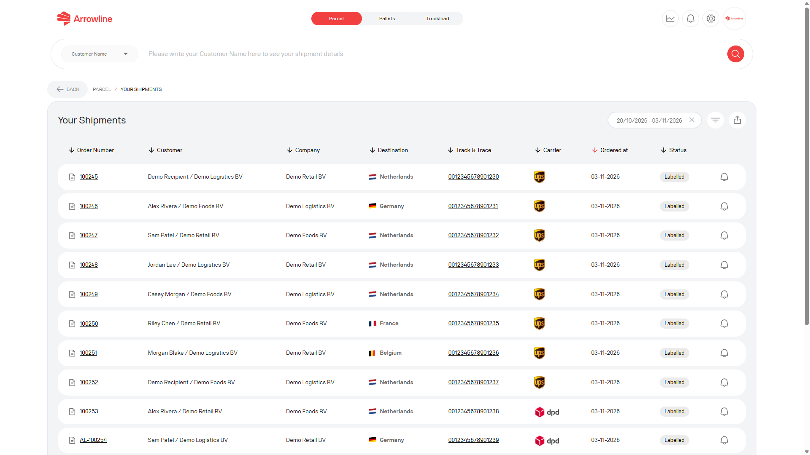
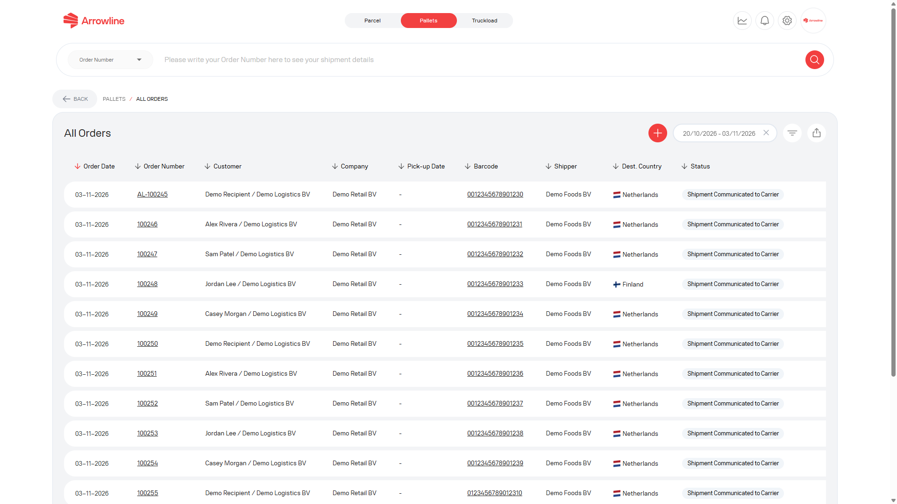
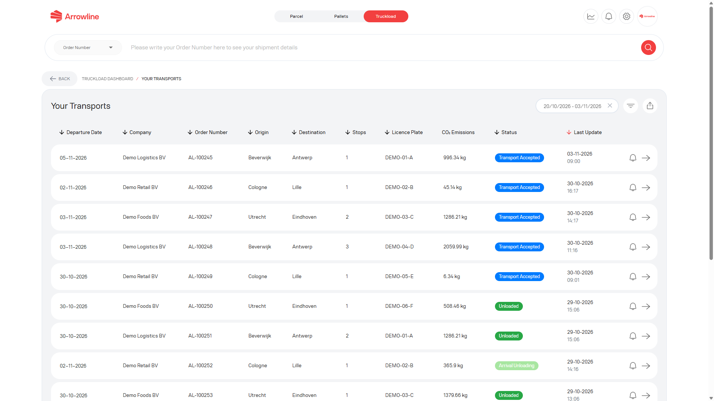

Search in the workspace that matches the shipment type. Parcels, Pallets and Truckloads do not share one search box.

<Frame caption="Parcel shipment list. All rows use dummy data.">
  
</Frame>

## Signed-in Parcels

<Steps>
  <Step title="Open Parcels">Sign in and open the Parcels workspace.</Step>
  <Step title="Open the shipment list">Go to the parcel shipment list.</Step>
  <Step title="Search or filter">Use the order number and the date, status or other list filters that are shown.</Step>
  <Step title="Check the row">Confirm the customer, destination, carrier, date and status before you continue.</Step>
</Steps>

The parcel list can show order number, customer, destination, track and trace, carrier, ordered date and status.

The list starts with a limited date range. Widen the dates if the shipment is older than the default window.

## Signed-in Pallets

<Steps>
  <Step title="Open Pallets">Sign in and open the Pallets workspace.</Step>
  <Step title="Open the pallet shipment list">Use [Pallet shipments](/pallets/shipments) when you already have an order or barcode.</Step>
  <Step title="Filter the list">Use the date, status, shipper or destination filters that are shown, together with the order number or barcode.</Step>
  <Step title="Open the matching record">Open the order or package and confirm the destination before you continue.</Step>
</Steps>

<Frame caption="Pallet shipment list with dummy orders.">
  
</Frame>

Distributor accounts may only see pallet shipments for permitted destination countries.

## Signed-in Truckloads

<Steps>
  <Step title="Open Truckloads">Sign in and open the Truckloads workspace.</Step>
  <Step title="Open the shipment list">Use [Truckload shipments](/truckloads/shipments).</Step>
  <Step title="Filter the list">Use the order number and the date, origin, destination or status filters that are shown.</Step>
  <Step title="Open the matching transport">Confirm the origin, destination and licence plate before you continue.</Step>
</Steps>

<Frame caption="Truckloads list. Origin, destination and plate are dummy.">
  
</Frame>

## Public pallet tracking

If you only need to follow a pallet and do not have a portal login, use [Track a pallet without signing in](/pallets/public-tracking).

On that page, choose **Order Number** or **Tracking Number**, enter the complete identifier and search.

<Warning>
  Public tracking is for Pallets only. It will not find a parcel or a truckload. If a pallet order has more than one barcode, choose the correct barcode on the tracking detail page.
</Warning>

## If nothing is found

See [A shipment cannot be found](/support/shipment-not-found). Include the order number and, for pallets, the barcode or tracking number. For a truckload, also include origin, destination and the licence plate when you have them.
