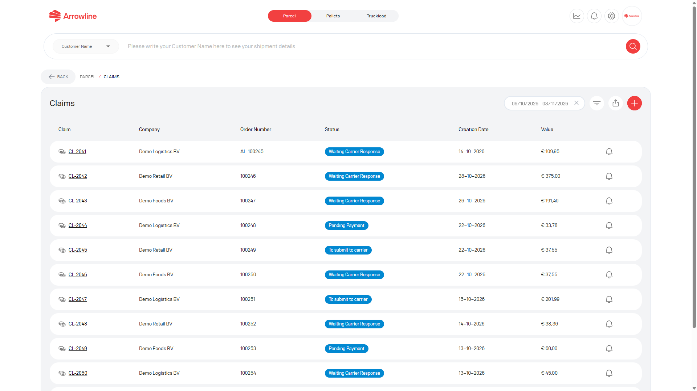
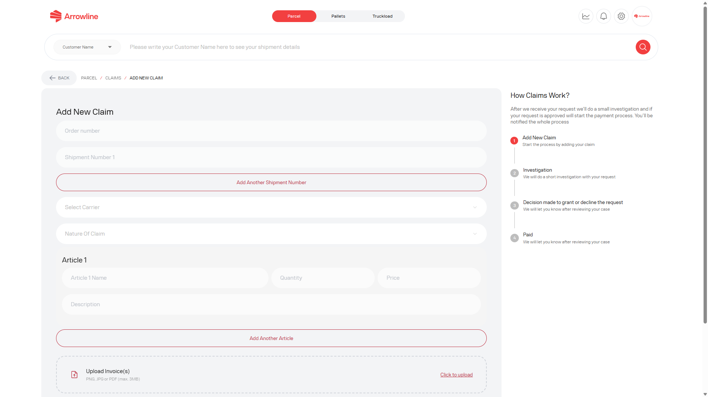
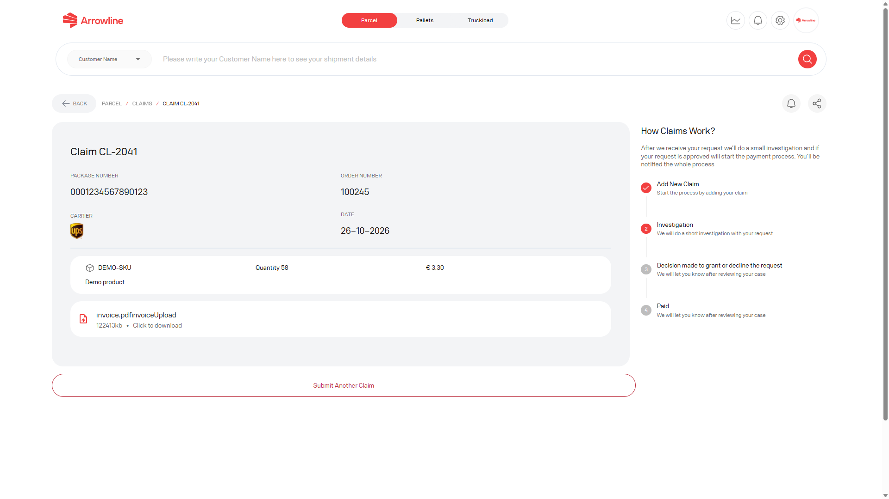

Utilize uma reclamação de paletes para um incidente formal como danos, falta ou perda. Uma reclamação é independente do estado de tracking e independente de um ticket de apoio.

<Frame caption="Imagem de exemplo com dados ficticios de Demo Logistics BV.">
  
</Frame>

## Consultar reclamações existentes

A lista de reclamações de paletes não é a lista de reclamações de encomendas. Mostra os casos de paletes da sua empresa.

Pode:

- Filtrar por data, estado ou empresa
- Exportar a lista filtrada
- Abrir o resultado de uma reclamação
- Ativar ou desativar as notificações de reclamação
- Iniciar uma nova reclamação

Cada linha pode mostrar um identificador de reclamação, a encomenda ou o código de barras associado quando estiver guardado, o tipo, o estado e as datas. Se uma referência estiver em falta, trate-a como indisponível.

## Criar uma reclamação

<Steps>
  <Step title="Abrir reclamações Paletes">A partir do espaço de trabalho Paletes, abra Claims e inicie uma nova reclamação.</Step>
  <Step title="Introduzir o envio">Adicione o número de encomenda e cada código de barras. Escolha a transportadora e a natureza da reclamação. A lista de transportadoras inclui Van Duuren, Geodis e CTS.</Step>
  <Step title="Adicionar os artigos">Para cada artigo, introduza o nome, a quantidade, o preço e uma descrição do problema.</Step>
  <Step title="Anexar os ficheiros obrigatórios">Adicione a fatura. Adicione fotografias, salvo se a natureza da reclamação for lost.</Step>
  <Step title="Verificar o total">O portal soma quantidade × preço de cada artigo para mostrar o valor da reclamação.</Step>
  <Step title="Enviar uma só vez">Aguarde a página de resultado da reclamação. Não envie a mesma reclamação outra vez.</Step>
</Steps>

<Frame caption="Imagem de exemplo com dados ficticios de Demo Logistics BV.">
  
</Frame>

O formulário não é enviado até os campos obrigatórios estarem preenchidos.

## Depois de enviar

A página de resultado da reclamação mostra o estado do caso, o progresso, a encomenda, o código de barras e a transportadora associados quando disponíveis, comentários e anexos, e um controlo de notificações.

<Frame caption="Imagem de exemplo com dados ficticios de Demo Logistics BV.">
  
</Frame>

<Warning>
  Não crie uma segunda reclamação de paletes para os mesmos códigos de barras, salvo se a Support lho pedir. Um estado de tracking Delivered pode mesmo assim ter uma reclamação em aberto.
</Warning>
