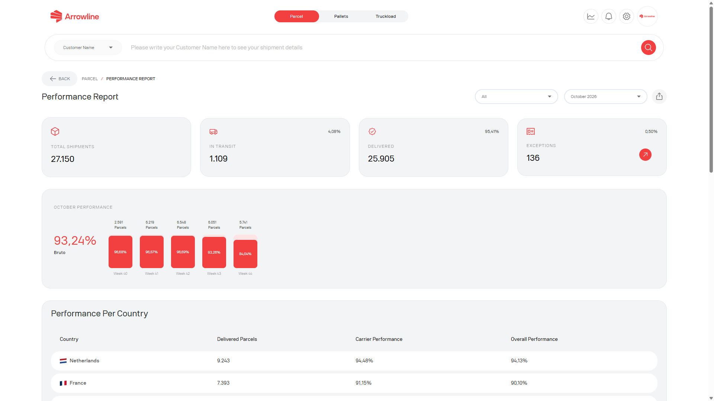

O relatório de desempenho Encomendas é uma página Encomendas com sessão iniciada. Serve para um período de relatório, não para um único envio.

<Frame caption="Imagem de exemplo com dados ficticios de Demo Logistics BV.">
  
</Frame>

## Abrir o relatório

<Steps>
  <Step title="Abrir Encomendas">Inicie sessão e abra o espaço de trabalho Encomendas.</Step>
  <Step title="Abrir o relatório de desempenho">Utilize o relatório a partir do painel Encomendas quando for apresentado.</Step>
  <Step title="Escolher o período">Defina a data ou o mês que pretende consultar.</Step>
  <Step title="Ler os resultados">Verifique os totais de estado, os cartões de desempenho, o gráfico e a tabela por país.</Step>
  <Step title="Transferir um PDF">Exporte o relatório que está no ecrã, incluindo o período selecionado.</Step>
</Steps>

O relatório precisa do módulo Encomendas. Se não o conseguir abrir, a sua empresa pode não ter essa página.

<Info>
  Utilize [Envios Encomendas](/pt/parcels/shipments) quando precisar de uma encomenda individual. Este relatório é para um período, não para uma encomenda.
</Info>
