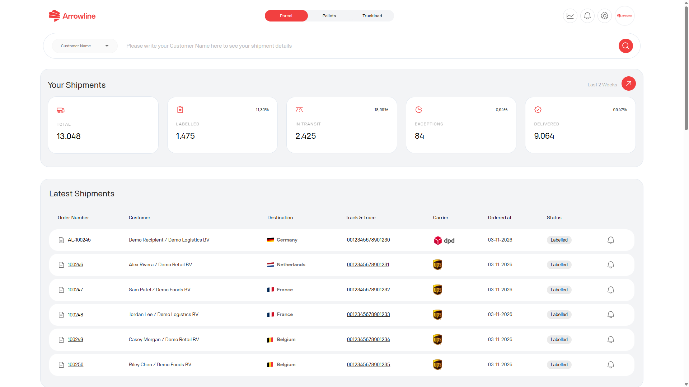

O portal agrupa os eventos em bruto da transportadora em categorias operacionais no painel Encomendas e na lista de envios. As categorias que pode esperar são:

- In transit
- Exceptions
- Delivered

A etiqueta numa linha é este estado agrupado, não o nome de cada leitura subjacente.

<Frame caption="Imagem de exemplo com dados ficticios de Demo Logistics BV.">
  
</Frame>

## Como ler um estado

- Verifique o carimbo de data e hora do evento mais recente
- Verifique o destino e a transportadora na mesma linha
- Veja se o estado está no grupo Exceptions
- Volte a consultar mais tarde se um evento mais recente ainda puder chegar

As horas vêm do evento que o portal recebeu. Podem diferir da hora do seu relógio.

## Os estados não são casos de apoio

Uma encomenda pode mostrar **Delivered** enquanto uma [reclamação](/pt/parcels/claims) ainda está em aberto. Uma encomenda pode mostrar **In transit** enquanto um [ticket](/pt/parcels/tickets) está a ser tratado.

| Grupo de estado | Passo seguinte típico |
| --- | --- |
| In transit | Aguarde a próxima atualização, ou abra um ticket se a encomenda estiver em atraso |
| Exceptions | Siga [Exceções de entrega](/pt/parcels/delivery-exceptions) |
| Delivered | Feche a tarefa, ou abra uma reclamação se houver danos, falta ou perda |

Se o estado agrupado parecer errado, guarde o número de encomenda e o valor de track-and-trace e siga [O estado de um envio não é atualizado](/pt/support/status-not-updated).
