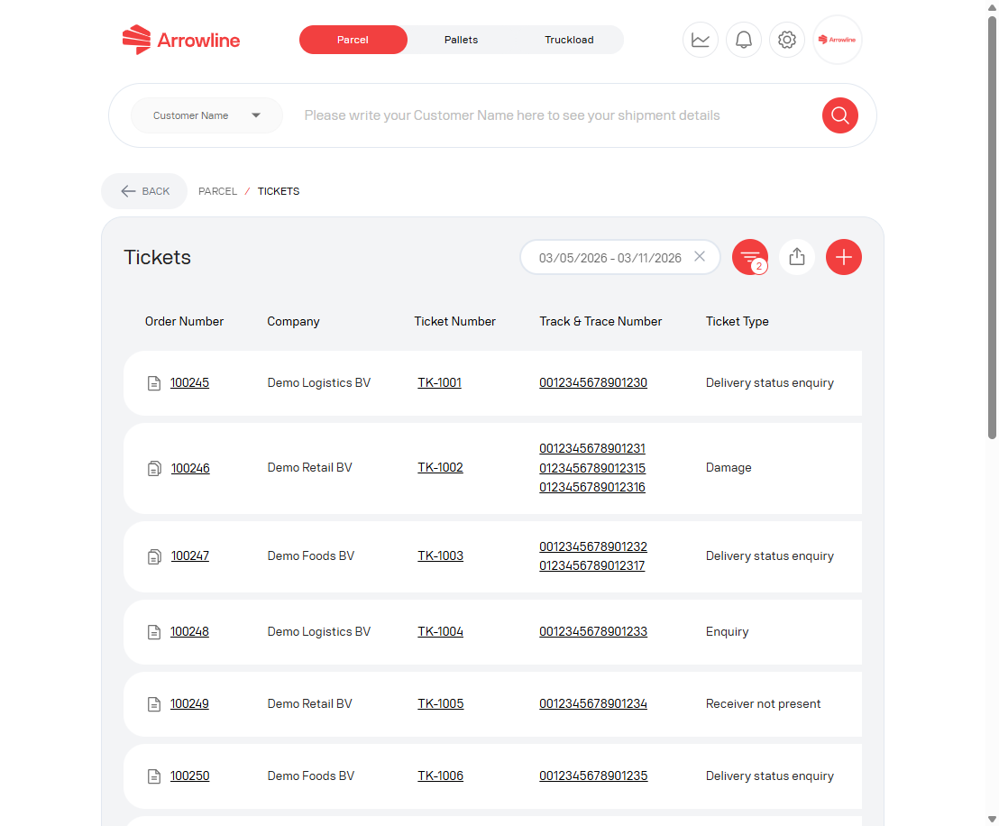
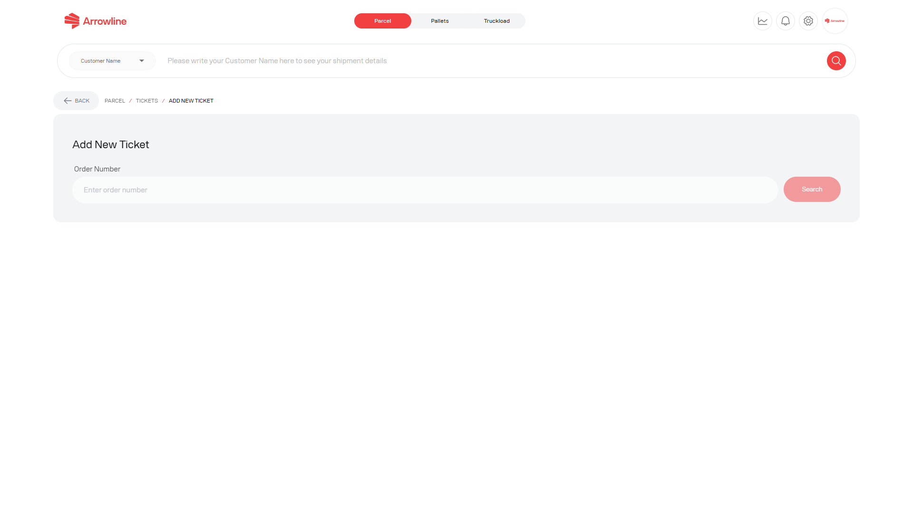

Utilize um ticket de encomenda quando precisar de uma investigação e o problema não for uma reclamação formal. Tickets e reclamações são listas separadas.

<Frame caption="Imagem de exemplo com dados ficticios de Demo Logistics BV.">
  
</Frame>

## Consultar tickets existentes

A lista de tickets pode mostrar número de ticket, assunto, categoria, prioridade, estado e última atualização.

Pode filtrar, exportar a lista filtrada, abrir uma conversa ou criar um ticket.

## Criar um ticket

<Steps>
  <Step title="Abrir tickets Encomendas">A partir do espaço de trabalho Encomendas, abra Tickets e inicie um novo ticket.</Step>
  <Step title="Procurar a encomenda">Introduza o número de encomenda completo. O portal não continua se a encomenda for desconhecida.</Step>
  <Step title="Selecionar um ou mais códigos de barras">Escolha os números de track-and-trace que pertencem ao problema. Tem de selecionar pelo menos um.</Step>
  <Step title="Escolher o tipo de problema">Selecione uma categoria e, em seguida, uma subcategoria. Alterar a categoria limpa uma subcategoria incompatível.</Step>
  <Step title="Descrever o problema">Escreva o que esperava, o que o portal mostra e quando aconteceu.</Step>
  <Step title="Anexar ficheiros se necessário">Cada ficheiro pode ter até 50 MB.</Step>
  <Step title="Enviar uma só vez">O portal constrói o assunto a partir do número de encomenda, dos códigos de barras selecionados e da categoria.</Step>
</Steps>

<Frame caption="Imagem de exemplo com dados ficticios de Demo Logistics BV.">
  
</Frame>

Se todos os códigos de barras da encomenda já tiverem um ticket, o formulário fica bloqueado. Abra o ticket existente.

Algumas contas de administrador podem escolher um contexto de empresa antes de enviar. Os outros utilizadores enviam na sua própria empresa.

## Acompanhar a conversa

Abra o ticket a partir da lista. A conversa mostra o histórico, os comentários, os anexos e o envio associado quando estiver disponível.

<Frame caption="Imagem de exemplo com dados ficticios de Demo Logistics BV.">
  
</Frame>

Responda nessa conversa. Não abra um segundo ticket para os mesmos códigos de barras.

Consulte [Acompanhar um ticket](/pt/support/track-ticket) e [Informação de que a Support precisa](/pt/support/required-information).
