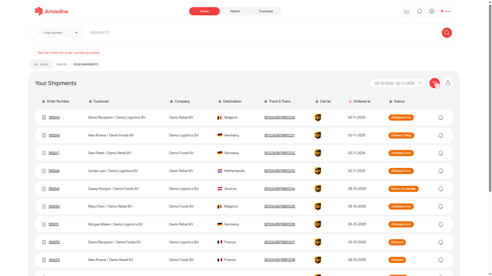

<Frame caption="Imagem de exemplo com dados ficticios de Demo Logistics BV.">
  
</Frame>

## Verifique estes pontos

1. Confirme que está em **Encomendas**, **Paletes** ou **Cargas completas**, e não noutro espaço de trabalho.
2. Pesquise pelo número de encomenda completo.
3. Para paletes, pesquise também pelo código de barras ou pelo número de tracking completo.
4. Para uma carga completa, verifique também a origem, o destino e a matrícula.
5. Em [envios Encomendas](/pt/parcels/shipments) ou [Envios Cargas completas](/pt/truckloads/shipments), alargue o intervalo de datas.
6. Para uma devolução, utilize [Devoluções Encomendas](/pt/parcels/returns). As devoluções não estão na lista de saída.
7. Para uma encomenda de paletes não confirmada, verifique [Encomendas Incoming](/pt/pallets/incoming-orders).
8. Se só precisar do progresso de uma palete, experimente o [seguimento público de paletes](/pt/pallets/public-tracking).

Se o registo continuar em falta, recolha o tipo de produto, o número de encomenda e qualquer código de barras, número de tracking ou matrícula. Para Encomendas ou Paletes, crie um ticket. Para Cargas completas, [contacte a Support](/pt/support/contact). Consulte [Informação de que a Support precisa](/pt/support/required-information).
