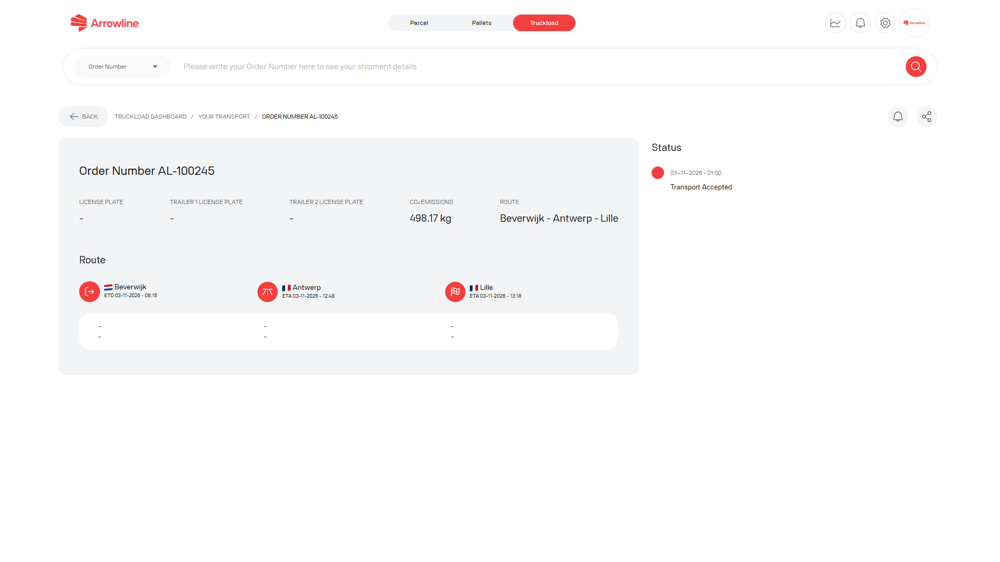

Abra um transporte a partir da [lista de envios Cargas completas](/pt/truckloads/shipments) quando precisar de mais do que a linha da lista.

<Frame caption="Imagem de exemplo com dados ficticios de Demo Logistics BV.">
  
</Frame>

## O que verificar

A página de detalhe pode incluir:

1. Factos do transporte e da encomenda
2. Origem, destino e paragens
3. Horas de chegada e de partida
4. Dados do veículo ou da transportadora quando o portal os mostrar
5. Estado mais recente
6. Notificações de estado para este transporte

Utilize apenas a informação que o portal mostra. Se um campo de veículo, transportadora ou hora estiver vazio, trate-o como indisponível. Não assuma um valor a partir de outro envio.

## Páginas Cargas completas relacionadas

| Se precisar de | Abra |
| --- | --- |
| A lista de trabalho | [Envios Cargas completas](/pt/truckloads/shipments) |
| Planned, In Transit ou Arrived | [Estados Cargas completas](/pt/truckloads/statuses) |
| Um resultado de período, não um transporte | [Relatório de desempenho Cargas completas](/pt/truckloads/performance) |
| Ajuda da Arrowline | [Contactar a Support](/pt/support/contact) |

<Tip>
  Guarde o número de encomenda, a origem, o destino e a matrícula antes de contactar a Support. Consulte [Informação de que a Support precisa](/pt/support/required-information).
</Tip>
