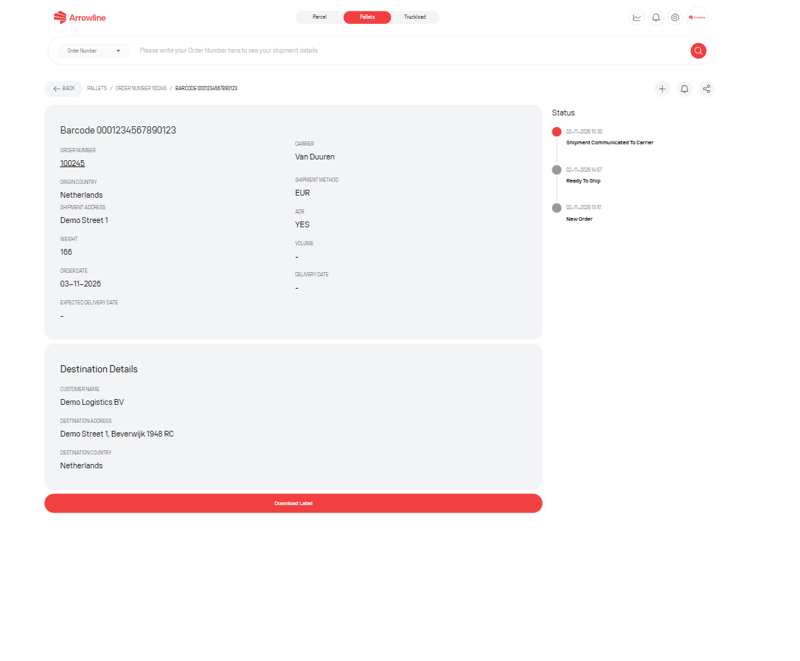

Statusurile de paleți vin din istoricul de status al paletului. Portalul mapează acele evenimente în numele pe care le vedeți în listă și pe cronologia pachetului.

Citiți cel mai recent eveniment pe [pagina pachetului](/ro/pallets/package-detail). Cronologia acelui barcode este locul unde urmăriți progresul.

<Frame caption="Imagine exemplu cu date fictive Demo Logistics BV.">
  
</Frame>

## Statusuri de planificare

Aceste statusuri sunt folosite în fluxul de planificare după autentificare:

| Status | Ce înseamnă în portal |
| --- | --- |
| Incoming | Comanda nu are încă un status cel mai recent și apare în lista Incoming |
| Ready To Ship | Ați confirmat expedierea în Incoming Orders |
| Shipment Communicated to Carrier | Expedierea a fost transmisă transportatorului. Revert poate fi blocat după acest punct |
| Order Cancelled | Comanda este anulată |

## Nume de mișcare și livrare pe care le puteți vedea

Aceste nume pot apărea în listă și pe cronologia pachetului:

| Status | Ce înseamnă în portal |
| --- | --- |
| Picked Up | Paletul a fost ridicat |
| Arrival HUB | Paletul a ajuns într-un hub |
| In Transit | Paletul se deplasează între locații |
| Out for Delivery | Paletul este pe drum pentru livrarea finală |
| Delivered | Paletul a fost livrat |
| Delivered, Partially Missing | Paletul a fost livrat, dar o parte din mărfuri lipsește |
| Delivered on Appointment | Paletul a fost livrat la o programare convenită |
| Delivered, Partly Delivered | Paletul a fost livrat doar parțial |
| Damaged | Paletul sau mărfurile au fost raportate ca deteriorate |
| Refused | Livrarea a fost refuzată |
| Address closed | Adresa de livrare era închisă |
| Returned | Paletul este returnat sau a fost returnat |
| On hold | Expedierea este On hold |
| Missing in network | Paletul lipsește din rețeaua transportatorului |

## Statusurile nu sunt cazuri de asistență

Un palet poate afișa **Delivered** în timp ce o [reclamație](/ro/pallets/claims) este încă deschisă. Un status de planificare poate părea normal în timp ce un [tichet](/ro/pallets/tickets) este în lucru.

Dacă cel mai recent eveniment lipsește sau pare greșit, nu recreați expedierea. Urmați [Statusul unei expedieri nu este actualizat](/ro/support/status-not-updated) și includeți order number și barcode-ul.
