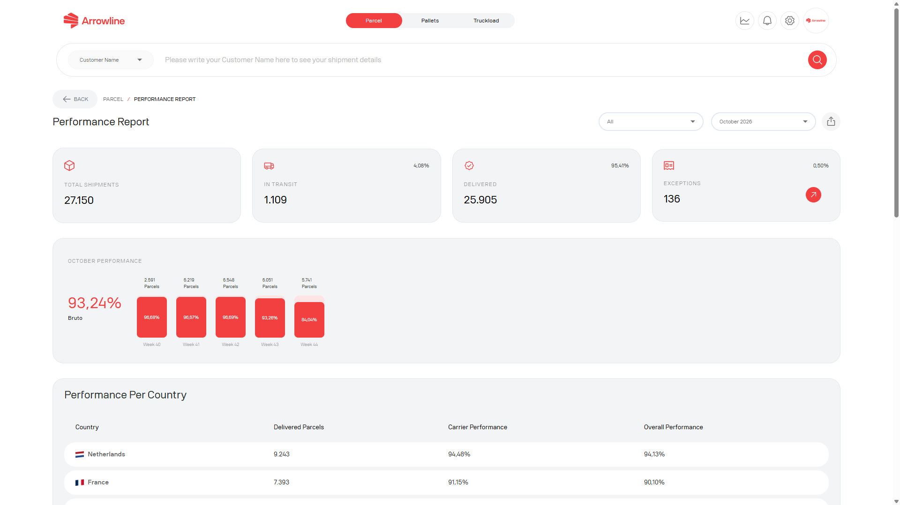

Raportul de performanță Colete este o pagină Colete după autentificare. Este pentru o perioadă de raportare, nu pentru o singură expediere.

<Frame caption="Imagine exemplu cu date fictive Demo Logistics BV.">
  
</Frame>

## Deschideți raportul

<Steps>
  <Step title="Deschideți Colete">Autentificați-vă și deschideți spațiul de lucru Colete.</Step>
  <Step title="Deschideți raportul de performanță">Folosiți raportul din tabloul de bord Colete când este afișat.</Step>
  <Step title="Alegeți perioada">Setați data sau luna pe care doriți să o consultați.</Step>
  <Step title="Citiți rezultatele">Verificați totalurile de status, cardurile de performanță, graficul și tabelul pe țări.</Step>
  <Step title="Descărcați un PDF">Exportați raportul de pe ecran, inclusiv perioada selectată.</Step>
</Steps>

Raportul are nevoie de modulul Colete. Dacă nu îl puteți deschide, este posibil ca pagina să nu fie disponibilă pentru compania dumneavoastră.

<Info>
  Folosiți [Expedieri Colete](/ro/parcels/shipments) când aveți nevoie de o comandă individuală. Acest raport este pentru o perioadă, nu pentru un singur colet.
</Info>
