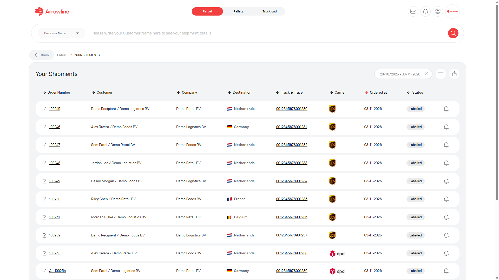
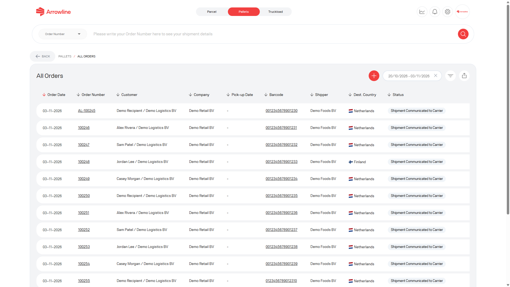
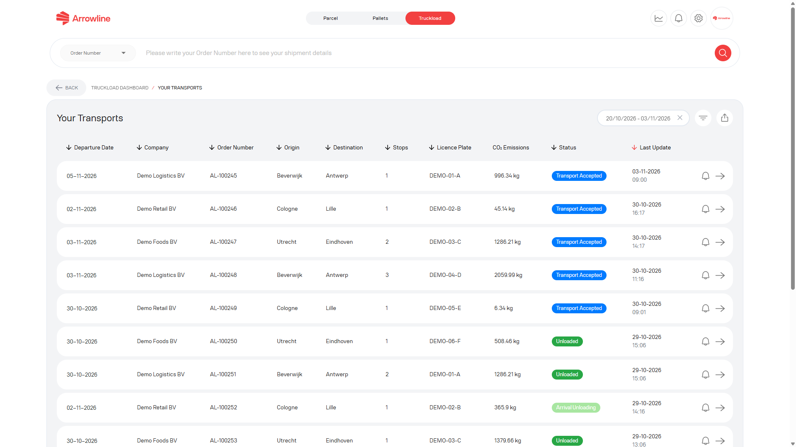

Căutați în spațiul de lucru care corespunde tipului de expediere. Colete, Paleți și Transporturi complete nu partajează o singură casetă de căutare.

<Frame caption="Imagine exemplu cu date fictive Demo Logistics BV.">
  
</Frame>

## Colete după autentificare

<Steps>
  <Step title="Deschideți Colete">Autentificați-vă și deschideți spațiul de lucru Colete.</Step>
  <Step title="Deschideți lista de expedieri">Mergeți la lista de expedieri de colete.</Step>
  <Step title="Căutați sau filtrați">Folosiți order number și filtrele de dată, status sau alte filtre de listă afișate.</Step>
  <Step title="Verificați rândul">Confirmați customer, destination, carrier, data și statusul înainte de a continua.</Step>
</Steps>

Lista de colete poate afișa order number, customer, destination, track and trace, carrier, ordered date și status.

Lista începe cu un interval de date limitat. Lărgiți datele dacă expedierea este mai veche decât fereastra implicită.

## Paleți după autentificare

<Steps>
  <Step title="Deschideți Paleți">Autentificați-vă și deschideți spațiul de lucru Paleți.</Step>
  <Step title="Deschideți lista de expedieri de paleți">Folosiți [Expedieri Paleți](/ro/pallets/shipments) când aveți deja un order number sau un barcode.</Step>
  <Step title="Filtrați lista">Folosiți filtrele de dată, status, shipper sau destination afișate, împreună cu order number sau barcode.</Step>
  <Step title="Deschideți înregistrarea potrivită">Deschideți comanda sau pachetul și confirmați destination înainte de a continua.</Step>
</Steps>

<Frame caption="Imagine exemplu cu date fictive Demo Logistics BV.">
  
</Frame>

Conturile de tip distributor pot vedea doar expedieri de paleți pentru țările de destinație permise.

## Transporturi complete după autentificare

<Steps>
  <Step title="Deschideți Transporturi complete">Autentificați-vă și deschideți spațiul de lucru Transporturi complete.</Step>
  <Step title="Deschideți lista de expedieri">Folosiți [Expedieri Transporturi complete](/ro/truckloads/shipments).</Step>
  <Step title="Filtrați lista">Folosiți order number și filtrele de dată, origin, destination sau status afișate.</Step>
  <Step title="Deschideți transportul potrivit">Confirmați origin, destination și licence plate înainte de a continua.</Step>
</Steps>

<Frame caption="Imagine exemplu cu date fictive Demo Logistics BV.">
  
</Frame>

## Urmărire publică a paleților

Dacă trebuie doar să urmăriți un palet și nu aveți autentificare în portal, folosiți [Urmăriți un palet fără autentificare](/ro/pallets/public-tracking).

Pe acea pagină, alegeți **Order Number** sau **Tracking Number**, introduceți identificatorul complet și căutați.

<Warning>
  Urmărirea publică este doar pentru Paleți. Nu va găsi un colet sau un transport complet. Dacă o comandă de palet are mai multe barcode-uri, alegeți barcode-ul corect pe pagina de detaliu a urmăririi.
</Warning>

## Dacă nu se găsește nimic

Consultați [O expediere nu poate fi găsită](/ro/support/shipment-not-found). Includeți order number și, pentru paleți, barcode-ul sau tracking number. Pentru un transport complet, includeți și origin, destination și licence plate, când le aveți.
