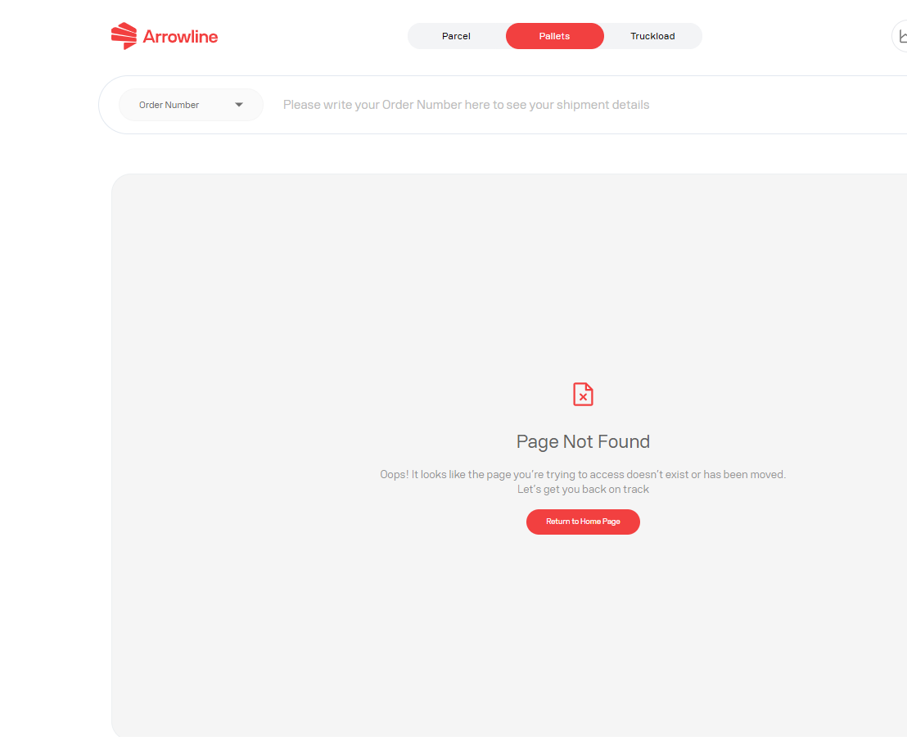

<Frame caption="Imagine exemplu cu date fictive Demo Logistics BV.">
  
</Frame>

## Ce să notați

- Mesajul exact de eroare
- Pagina pe care o foloseați, de exemplu Sign in, shipments, Incoming Orders, Claims sau Tickets
- Acțiunea pe care ați selectat-o
- Order number și barcode-ul sau valoarea track and trace
- Ora la care ați văzut eroarea
- O captură de ecran, cu adresele de e-mail și datele personale mascate

## Ce să faceți în continuare

1. Așteptați ca pagina să termine. Nu apăsați din nou Submit.
2. Reîmprospătați o dată.
3. Verificați dacă expedierea, reclamația sau tichetul a fost deja creat.
4. Dacă rezultatul tot nu este clar, creați **un** tichet cu notele de mai sus.

Un formular de reclamație sau de tichet poate bloca trimiterea când lipsesc câmpuri obligatorii. Completați formularul în loc să reîncercați o trimitere goală.

Dacă portalul este în mentenanță, așteptați și încercați mai târziu. Nu creați înregistrări duplicate.

Consultați [Informațiile de care are nevoie Support](/ro/support/required-information).
