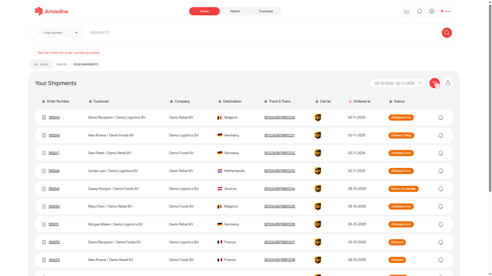

<Frame caption="Imagine exemplu cu date fictive Demo Logistics BV.">
  
</Frame>

## Verificați aceste puncte

1. Confirmați că sunteți în **Colete**, **Paleți** sau **Transporturi complete**, nu în alt spațiu de lucru.
2. Căutați după order number complet.
3. Pentru paleți, căutați și după barcode-ul sau tracking number complet.
4. Pentru un transport complet, verificați și origin, destination și licence plate.
5. Pe [expedieri Colete](/ro/parcels/shipments) sau [Expedieri Transporturi complete](/ro/truckloads/shipments), lărgiți intervalul de date.
6. Pentru un retur, folosiți [Retururi Colete](/ro/parcels/returns). Retururile nu sunt în lista outbound.
7. Pentru o comandă de palet neconfirmată, verificați [Incoming Orders](/ro/pallets/incoming-orders).
8. Dacă aveți nevoie doar de progresul paletului, încercați [urmărirea publică a paleților](/ro/pallets/public-tracking).

Dacă înregistrarea tot lipsește, adunați tipul de produs, order number și orice barcode, tracking number sau licence plate. Pentru Colete sau Paleți, creați un singur tichet. Pentru Transporturi complete, [contactați Support](/ro/support/contact). Consultați [Informațiile de care are nevoie Support](/ro/support/required-information).
