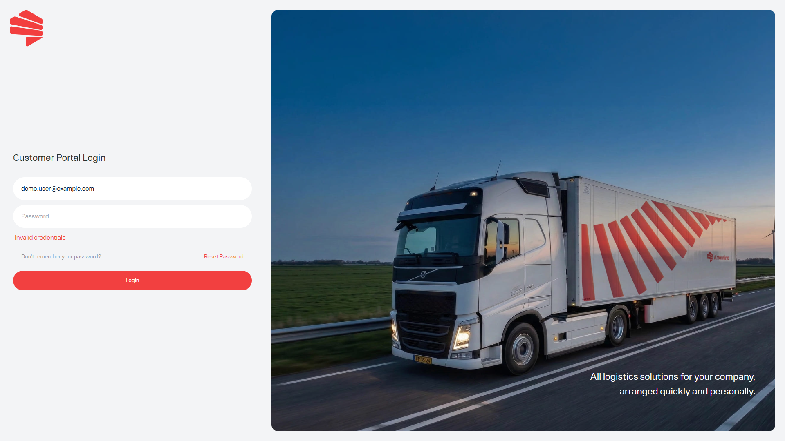

<Frame caption="Failed sign-in. The email is dummy data.">
  
</Frame>

## Check these points

1. Confirm that you are using the email address registered for the portal.
2. Re-enter your password carefully. The portal does not tell you whether the email address exists if sign-in fails.
3. Use [Reset your password](/start/password-reset) if you have forgotten your password.
4. After a successful sign-in, check [Choose your workflow](/start/choose-your-workflow). You only see the modules assigned to your company.
5. If you can sign in but Parcels or Pallets is missing, ask your portal administrator to check the company modules.

If access is still unavailable, contact Support with the email address you use to sign in. Never send the password or reset code.

<Warning>
  A saved link does not open a module that is not available to your account.
</Warning>
