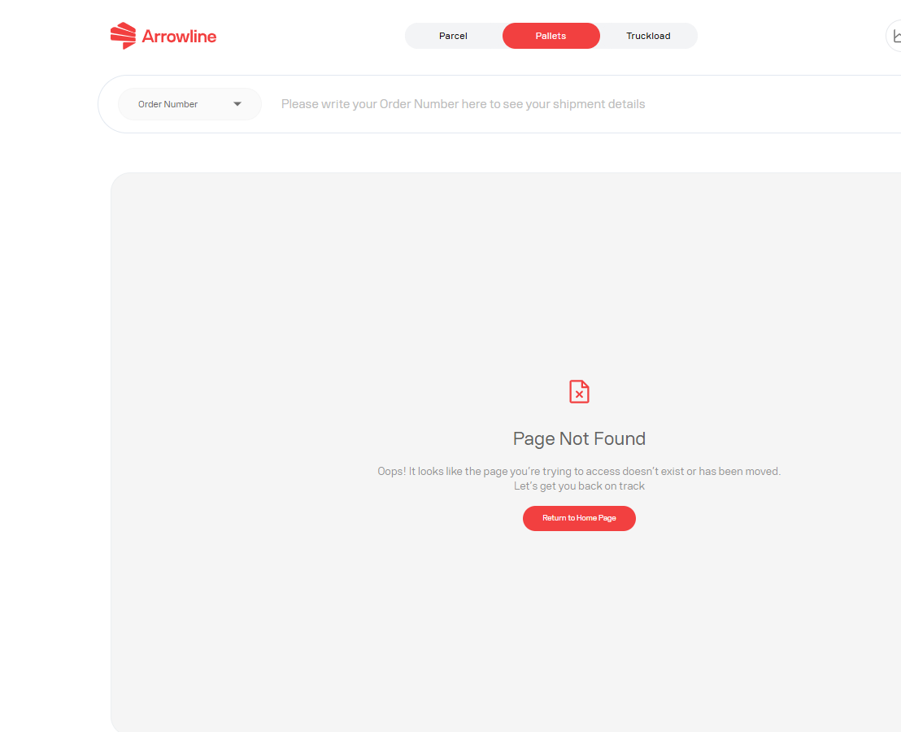

<Frame caption="Example portal error without customer data.">
  
</Frame>

## What to record

- The exact error message
- The page you were using, such as sign-in, shipments, incoming orders, claims or tickets
- The action you selected
- The order number and barcode or track-and-trace value
- The time you saw the error
- One screenshot, with emails and personal data masked

## What to do next

1. Wait for the page to finish. Do not click Submit again.
2. Refresh once.
3. Check whether the shipment, claim or ticket was already created.
4. If the result is still unclear, create **one** ticket with the notes above.

A claim or ticket form can block submit when required fields are missing. Complete the form instead of retrying an empty submission.

If the portal is in maintenance, wait and try again later. Do not create duplicate records.

See [Information Support needs](/support/required-information).
