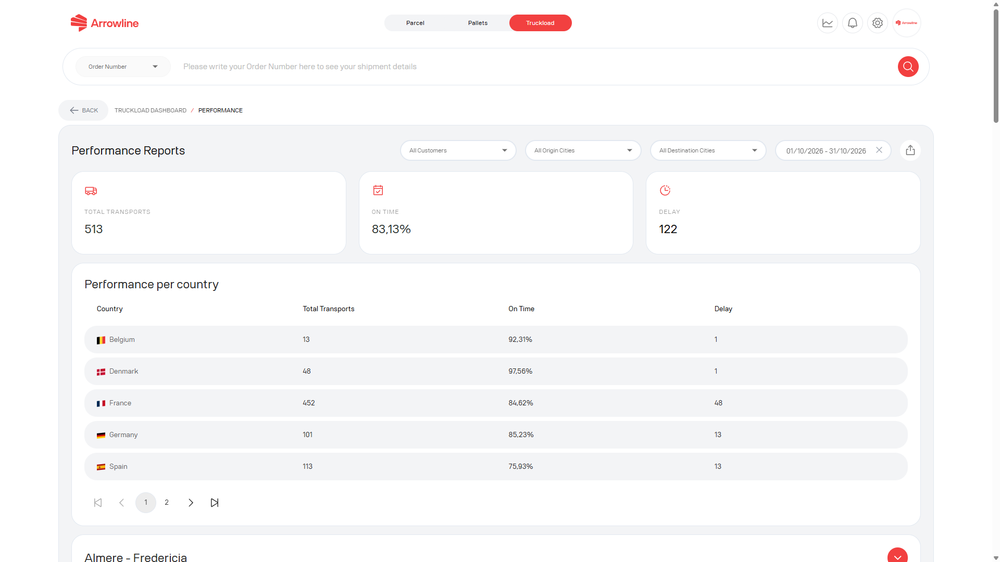

The Truckloads performance report is a signed-in Truckloads page. It is for a reporting period, not for one transport.

<Frame caption="Truckloads performance report with dummy totals.">
  
</Frame>

## Open the report

<Steps>
  <Step title="Open Truckloads">Sign in and open the Truckloads workspace.</Step>
  <Step title="Open the performance report">Use the report from the Truckloads dashboard when it is shown.</Step>
  <Step title="Choose the period">Set the date range you want to review.</Step>
  <Step title="Narrow the scope">Use the origin, destination or other filters shown on the page. A customer filter appears only for some administrator accounts.</Step>
  <Step title="Read the results">Check the totals, country or route tables and grouped transports.</Step>
  <Step title="Export">Export the report that is on screen, including the active filters.</Step>
</Steps>

The report needs the Truckloads module. If you cannot open it, your company may not have that page.

<Info>
  Use [Truckload shipments](/truckloads/shipments) when you need an individual transport. This report is for a period, not one truckload.
</Info>
