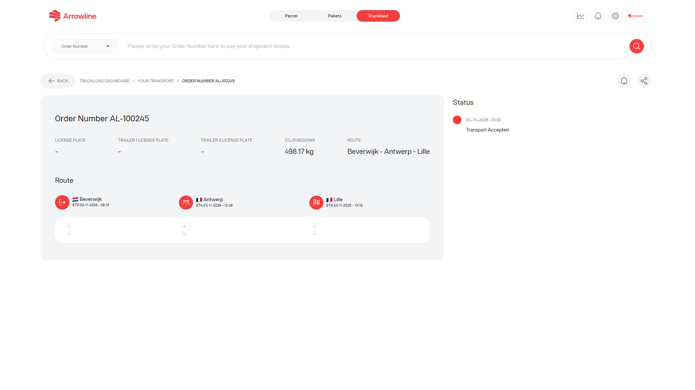

Open a transport from the [Truckloads shipment list](/truckloads/shipments) when you need more than the list row.

<Frame caption="Truckload AL-100245 with dummy stops.">
  
</Frame>

## What to check

The detail page can include:

1. Transport and order facts
2. Origin, destination and stops
3. Arrival and departure times
4. Vehicle or carrier data when the portal shows it
5. Latest status
6. Status notifications for this transport

Use only the information the portal shows. If a vehicle, carrier or time field is empty, treat it as unavailable. Do not assume a value from another shipment.

## Related Truckloads pages

| If you need | Open |
| --- | --- |
| The working list | [Truckload shipments](/truckloads/shipments) |
| Planned, In Transit or Arrived | [Truckload statuses](/truckloads/statuses) |
| A period result, not one transport | [Truckload performance report](/truckloads/performance) |
| Help from Arrowline | [Contact Support](/support/contact) |

<Tip>
  Keep the order number, origin, destination and licence plate before you contact Support. See [Information Support needs](/support/required-information).
</Tip>
